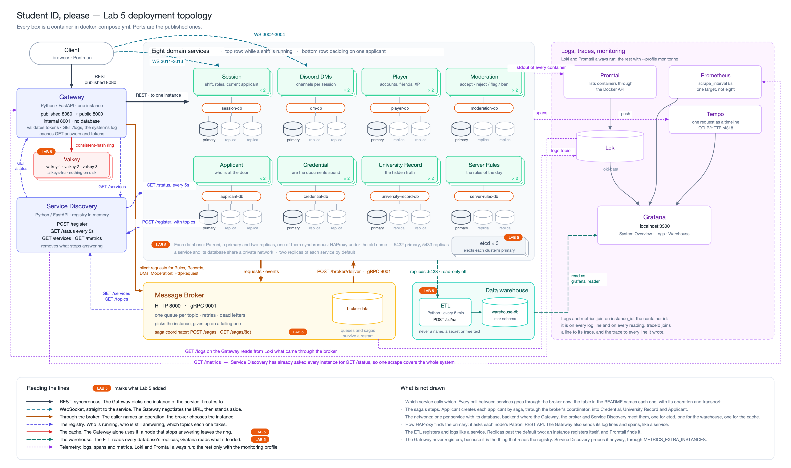
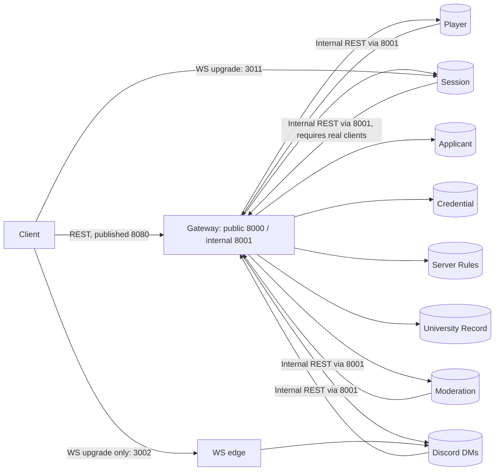
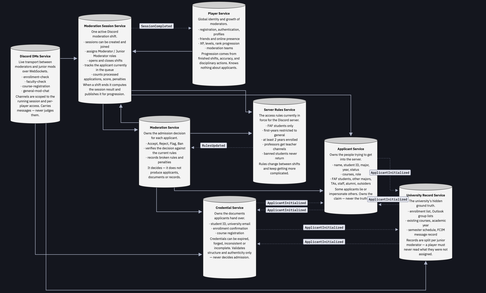
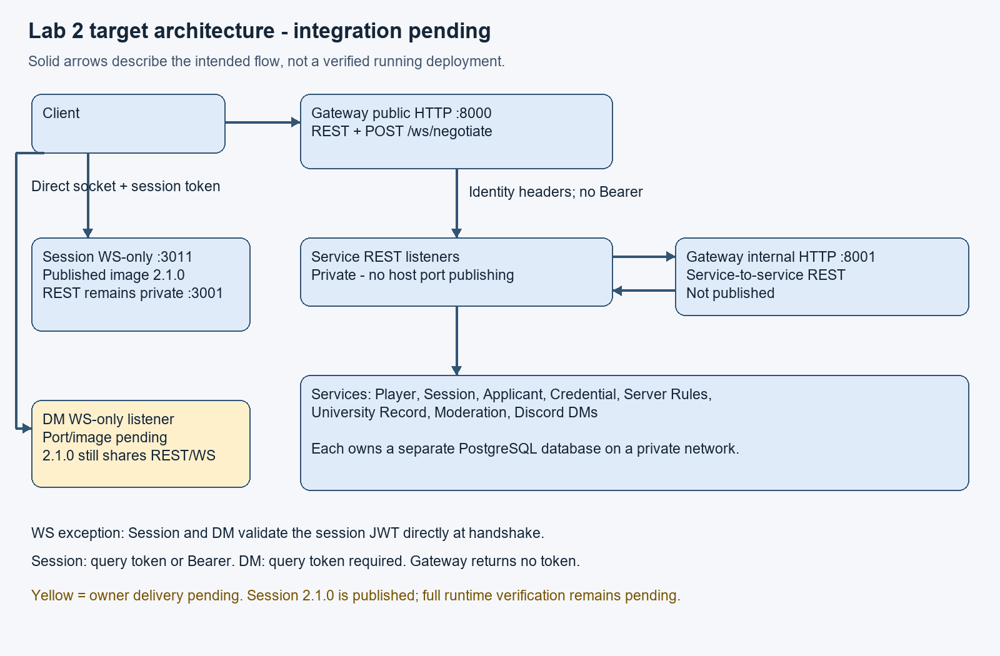

# Student ID, please

A game set in a university Discord server where a moderation team decides who gets access, based on credentials and information that may or may not be true. Each round an applicant arrives at the door: a student, an alumnus, a staff member or an outsider, presenting documents that may be forged, expired or simply someone else's. One player acts as Moderator and makes the call; the rest are Junior Moderators who each hold a different slice of the university's records and have to piece the truth together over chat before the Moderator decides.

## Contents

- [Service Boundaries](#service-boundaries)
- [Architecture Diagram](#architecture-diagram)
- [Technologies and Communication Patterns](#technologies-and-communication-patterns)
- [Communication Contract](#communication-contract)
  - [Through the broker](#through-the-broker)
  - [Service-to-service calls](#service-to-service-calls)
  - [Replicated databases](#replicated-databases)
  - [Creating an applicant across three databases](#creating-an-applicant-across-three-databases)
  - [Cache](#cache)
  - [Warehouse and ETL](#warehouse-and-etl)
- [Running the System](#running-the-system)
- [Monitoring](#monitoring)
- [GitHub Workflow](#github-workflow)
- [Project Board](#project-board)

## Service Boundaries

The system has eight domain services, a Gateway that routes and authenticates
REST requests, and a Service Discovery that keeps track of their running
instances. Each domain service owns its own data and business rules.

### 1. Player Service
Responsible for the identity of the players. Stores accounts, authentication, profiles, friends and XP/Levels. Tracks persistent player progression through leveling, based on moderator experience, completed shifts and disciplinary actions.

It holds nothing about the people attempting to join the server.

### 2. Server Moderation Session Service
Manages an active Discord moderation session. A session represents one moderation shift and contains a Moderator and several Junior Moderator players. Handles creating and joining sessions, assigning roles, starting/ending shifts, the current applicant, number of applications processed, and session score and penalties.

It is also the authority on role to access mapping: which Junior Moderator was assigned which records and which chat channels.

### 3. Applicant Service
Owns the people attempting to access the server. Generates applicants with information such as name, student ID, major, year, university status, courses and role, covering FAF students, students from other majors, teaching assistants, university staff, alumni and outsiders. Some applicants are generated with false information or as impersonation attempts.

It owns what the applicant *claims*, not whether the claim is true.

### 4. Credential Service
Owns the documents and credentials presented by applicants, such as student ID, university email, enrollment confirmation and course registration. Validates the structure and authenticity of credentials, which can be expired, forged, inconsistent or incomplete.

It decides whether a document is sound, never whether the applicant should be admitted.

### 5. Server Rules Service
Owns the current rules for accessing the Discord server. Rules can change between shifts and grow increasingly complex. Evaluates applicants against the current access rules.

It stores no applicant data of its own; it is handed what it needs per request and returns a verdict.

### 6. University Record Service
Provides the hidden university information moderators may need to verify an applicant, such as enrollment lists, email group lists, existing courses, academic year, semester schedule and server message records. This information is deliberately distributed among junior mod players, and the service enforces that a player cannot read a record type they were not assigned.

### 7. Moderation Service
Owns the admission decision for each applicant. The Moderator can Accept, Reject, Flag or Ban an applicant. Determines whether a decision was correct according to the current server rules, and records the applicant, decision, violated rules, penalties and outcome.

### 8. Discord DMs Service
Provides real-time communication between the moderator and the junior mods, over a Discord-like WebSocket interface. Manages channels tied to the current moderation session, with different players having access to different channels.

It transports messages and never judges whether what is said is correct.

### 9. Gateway Service

Python / FastAPI. Validates Player and Session tokens, forwards caller identity
without Authorization, separates public and internal REST, and applies task
timeout and concurrency limits. It owns no domain database. Its authenticated
`POST /ws/negotiate` endpoint returns the direct Session or DM WebSocket URL.

### 10. Service Discovery

Python / FastAPI. Keeps the registry of running service instances. Every
instance registers its own address on startup, Gateway reads the registry to
spread requests across the instances of a service, and Service Discovery calls
every instance's `GET /status` at a fixed interval, removing the ones that stop
answering. It owns no database: the registry is held in memory.

## Architecture Diagram

Lab 5 deployment topology. Every box is a container in `docker-compose.yml`:



Seven kinds of line, because the system now has seven ways for one container
to reach another: REST through the Gateway, a WebSocket straight to the
service, a call through the Message Broker, registry traffic, the cache, the
warehouse, and telemetry. What Lab 5 added carries an orange **LAB 5** tag:
every database is a Patroni cluster, a primary and two replicas behind HAProxy,
with etcd electing the primary ([Replicated databases](#replicated-databases)),
the broker coordinates the applicant saga, the Gateway caches in three Valkey
nodes ([Cache](#cache)), and the ETL loads the warehouse that Grafana reads
([Warehouse and ETL](#warehouse-and-etl)). No service calls another through the
Gateway's internal port any more: the calls between services, and the client
requests for the services in `BROKER_SERVICES`, go through the broker.
The drawing is generated — `python3 docs/architecture-lab5.py` rebuilds the
PNG from the layout in that file, so the diagram cannot quietly fall behind the
Compose file it describes.

What the picture does not say, and the sections below do: which service calls
which ([Service-to-service calls](#service-to-service-calls)), what moved onto
the broker ([Through the broker](#through-the-broker)), and what the
monitoring containers collect ([Monitoring](#monitoring)).

Lab 2 deployment topology, kept because it is the shape the Gateway was built
for and the broker did not change it:



Only Gateway publishes REST. Session and DM still validate Session tokens at
their WS handshakes. Neither published WS port carries a REST route, so
neither can be used to forge Gateway identity: Session answers `426` on a
listener that serves upgrades alone, and Discord DMs publishes only its
WebSocket listener, `3001`, never its REST port `3000`. (The Lab 2 WS edge
above is gone: Discord DMs publishes that listener itself.) Gateway negotiates
their public URLs
using SESSION_PUBLIC_WS_BASE_URL and DM_PUBLIC_WS_BASE_URL. Read
[integration status](docs/gateway-integration.md) for
the image/client dependencies before treating this topology as a finished game.

The original domain-interaction diagram remains useful for business ownership:



Each cylinder is a service with its own database. A solid arrow is a synchronous
REST call, pointing from the caller to the service it calls. A dotted arrow is a
notification, labelled with its name. The diagram dates from Lab 0, when these
were planned as broker events; each is a REST call as well now (see
[Service-to-service calls](#service-to-service-calls)).

Every solid REST arrow in this domain diagram goes through Gateway's internal
listener in Lab 2. The domain responsibilities remain independent:

- **Player** opens a session for a team, and hears back from Session through
  `SessionCompleted` to award progression.
- **Session** runs the shift: it asks Server Rules for the shift's rule set,
  Applicant for each applicant, and Moderation for the decision log when the
  shift ends.
- **Moderation** judges each decision on its own. It reads the claim from
  Applicant, has Credential check the documents, asks Server Rules for the
  correct verdict under the session's current rule set, and reports the outcome
  to Session.
- **Applicant, Credential and University Record** each keep a slice of every
  applicant. In this design whichever was contacted first created the applicant
  and handed its story to the other two, hence an arrow in both directions
  between every pair. Since Lab 5 only Applicant creates one, by a saga on the
  broker: see [Creating an applicant across three databases](#creating-an-applicant-across-three-databases).
- **Discord DMs** checks channel access with Session, and fetches a document
  from Credential or a record from University Record when a player shares one
  into a channel.

## Technologies and Communication Patterns

We work in two languages, and the split follows the service pairs each of us
owns: two of us write our two services in **TypeScript (NestJS)**, the other two
write theirs in **PHP (Laravel)**. The pairs were drawn so that the language
boundary mostly falls along a natural seam in the system — the services that
coordinate the game and push real-time updates (Session, Moderation, Discord
DMs) are TypeScript, and the services that generate, store and validate data
(Applicant + Credential, Server Rules + University Record) are PHP. The one
exception is Player, which is TypeScript because it shares an owner with
Session (see below). Nobody has to switch stacks mid-semester.

TypeScript/NestJS earns its place on the real-time and orchestration cluster.
NestJS ships WebSocket gateways, so the two real-time surfaces (moderator chat,
live session state) come from the framework instead of being bolted on. Its type system
also keeps the heavily typed contract below honest at compile time.

Player Service is TypeScript for an ownership reason, not a technical one. On
its own it is CRUD, JWT issuance, one outbound call and one notification to take in, and
would sit comfortably in Laravel — it started there. It moved because the same
teammate owns Player and Session, and Session has to be TypeScript. One person on
one stack is worth more than the marginally better fit, and the contract between
them (`POST /sessions` and `SessionCompleted`) is small enough that nothing is
lost either way.

PHP/Laravel earns its place on the data cluster. These four services are mostly
CRUD and payload validation — generate a coherent (and often deliberately
inconsistent) applicant, store records, check a document against a schema — and
Eloquent together with Laravel's form-request validation cover exactly that with
little ceremony. It is also the stack their owners are fastest in, which matters
under a weekly lab cadence: a working, well-understood service beats a
marginally lighter one we have to fight. The trade-off is that Laravel is a
heavier runtime than a PHP microframework, and PHP is weaker at long-lived
real-time and async work than Node — which is precisely why the real-time and
orchestration cluster is TypeScript, not PHP.

Every service owns its own PostgreSQL database. No service reads another's
tables; the only route to another service's data is through its endpoints.
This is deliberate — a shared database would let us skip the
contract, which is the one thing Lab 0 exists to force us to get right.

| Service | Language / Framework | Datastore | Talks via | Why |
|---|---|---|---|---|
| Player | TypeScript / NestJS | PostgreSQL | REST; gRPC through the broker | Identity, friends and levels; same owner as Session, so same stack |
| Session | TypeScript / NestJS | PostgreSQL | REST, WebSocket; gRPC, messages and events through the broker | Runs the shift, pushes live state, owns role→access |
| Applicant | PHP / Laravel | PostgreSQL | REST; gRPC through the broker | Presented claim and deception; can start an applicant |
| Credential | PHP / Laravel | PostgreSQL | REST; gRPC through the broker | Signs, stores and validates documents; can start an applicant |
| Server Rules | PHP / Laravel | PostgreSQL | REST; gRPC through the broker | Rule generation, storage and verdict evaluation |
| University Record | PHP / Laravel | PostgreSQL | REST; gRPC through the broker | Access-controlled ground-truth store |
| Moderation | TypeScript / NestJS | PostgreSQL | REST; gRPC through the broker | Decides and scores the admission from Applicant, Credential and Rules |
| Discord DMs | TypeScript / NestJS | PostgreSQL | WebSocket, REST; gRPC through the broker | Real-time per-session chat |
| Gateway | Python / FastAPI | None | REST, WS URL negotiation; the broker for Rules and Records | Validates tokens, routes and limits requests, serves the system's log |
| Service Discovery | Python / FastAPI | None | REST | Registry of running instances, their health checks and their topics |
| Message Broker | Python: standard library, gRPC, OpenTelemetry | SQLite, for queued events | Message envelopes over HTTP, a gRPC proxy, topics | Carries requests, events and log lines between services, and picks the instance |

Three communication patterns are in use, each where it fits:

- **REST from the client through the Gateway.** Every request a player makes
  enters at the Gateway, which checks the token and routes it to one instance.
  For Server Rules and University Record it hands the request to the broker
  instead.
- **Through the Message Broker, between services.** A service does not call
  another one directly: it names the operation and the broker finds an
  instance through Service Discovery, balances by load, and reroutes when an
  instance fails. Calls that need an answer are requests, mostly gRPC through
  the broker's proxy on port 9001. News that another service may want is an
  event on a topic, queued durably and retried, and parked as a dead letter if
  it never lands. The services' log lines travel the same way, on the `logs`
  topic. See [Through the broker](#through-the-broker).
- **WebSockets** carry the two real-time surfaces: the moderator / junior-mod
  chat in Discord DMs, and the live session state (current applicant, score)
  pushed by Session.

---

## Communication Contract

### Conventions

**Auth.** A caller authenticates once, at the Gateway. It is the only service
reachable from outside; the rest sit on internal networks and answer nothing
that did not come through it.

There are two kinds of JWT, both RS256, each still issued by the service that
owns it and signed with that service's private key. The Gateway holds both
issuers' public keys, and is the only place a token is checked.

- The **player token** is issued by Player Service on login and carries `sub`
  (the `playerId`). It is enough for player-scoped calls: profile, friends,
  teams.
- The **session token** is issued by Session when a player enters a session:
  to the moderator when Player opens it, and to junior mods on
  `POST /sessions/{id}/join`. `POST /sessions/{id}/token` re-issues it. It
  carries `sub`, `sessionId`, `role` and `recordAccess`, and expires after 15
  minutes. Session-scoped calls carry it: document and record reads, channel
  reads, decisions, and the two WebSocket handshakes.

Which token a call carries is unchanged; what changed is that the Gateway is
what reads it.

Every REST call except `POST /auth/*` carries `Authorization: Bearer <token>`
**to the Gateway**, which answers `401 INVALID_TOKEN` itself when it is missing,
expired or wrongly signed. `POST /auth/*` passes through untouched, since a
caller cannot present a token before logging in.

**The Gateway does not forward `Authorization`.** It validates the token, drops
the header, and passes what it learned to the service as headers:

| Header | Sent on | Value |
|---|---|---|
| `X-Player-Id` | every authenticated call | the token's `sub` |
| `X-Session-Id` | calls made with a session token | its `sessionId` |
| `X-Session-Role` | calls made with a session token | `moderator` or `junior_mod` |
| `X-Record-Access` | calls made with a session token | the record types, comma separated; sent empty when the player has none |

For REST, a service therefore never sees a token: it reads the identity from
these headers and trusts them, because nothing but the Gateway can reach it. A
service must not publish a port of its own, and a deployment that exposes one
breaks this guarantee for everybody.

Two things stay with the services. Player and Session keep their **private**
keys, because they still issue the tokens. Session and Discord DMs keep
Session's **public** key, for the WebSocket handshakes described below, which
do not pass through the Gateway. No other service holds a key.

**Internal endpoints.** Endpoints marked *internal* are called by another
service, never by a client, and every call between services goes through the
Gateway too. The Gateway is what keeps them internal: it refuses to route those
paths for a caller from outside. This replaces the shared `X-Service-Secret`
header used before the Gateway existed.

A service-to-service call carries no token: the caller is a service, not a
person, and the token was already consumed at the Gateway on the way in.
Usually it carries no identity either, because nobody in particular is asking:
Session asking Server Rules for a rule set, or any of the three services being
asked to start an applicant.

**Which door a request arrives at is what decides this.** The Gateway listens
on two ports:

| Port | Published outside | Serves |
|---|---|---|
| `8000` | yes | everything except endpoints marked *internal* |
| `8001` | no | everything, including internal endpoints |

A client can only reach `8000`, where an internal path answers
`403 INTERNAL_ENDPOINT`. Services reach `8001`, which is not published beyond
the Docker network, and call each other there:

```
http://gateway:8001/<service>/<path>
```

So `POST /sessions` becomes `POST http://gateway:8001/session/sessions` when
Player opens a shift. What a request may do depends on where it entered, not on
a secret each service checks.

**A service acting for a player says so.** Sometimes the caller is a service
but the request is still on someone's behalf: Discord DMs reads a record
because a player asked to share it, and University Record must apply *that
player's* record access, not Discord DMs'. The calling service therefore
forwards the four identity headers it received, unchanged, and the Gateway
passes them through on the internal port rather than stripping them as it does
on the public one.

A service that receives no identity headers must not fall back to allowing the
read: a per-applicant record read without `X-Record-Access` is `403`, the same
as a read whose access does not cover that record.

The trade-off is deliberate, and it is the consequence of having a single
authentication boundary: on the internal port any service can set those
headers to anything, so anything already inside the system is trusted.

**WebSockets are the exception.** The Gateway negotiates the connection and
hands the client a URL to reach the service directly, so it is not left sitting
in the middle of a long-lived socket. Those connections never pass through it
and carry no injected headers, so the services that own a socket, Session and
Discord DMs, validate the session token themselves on the handshake, against
Session's public key.

**Types.** `UUID` = RFC-4122 string. `timestamp` = ISO-8601 UTC. `date` =
ISO-8601 date. `enum(...)` = closed string set. All bodies are
`application/json`.

**Error envelope.**

```json
{ "error": "APPLICANT_NOT_FOUND", "message": "human readable", "details": {} }
```

Common statuses: `400` bad payload, `401` no/invalid token, `403` record,
document or channel access denied, `404` missing, `408` the request took longer
than the service allows, `409` conflict/idempotency, `422` validation, `429`
the service is already handling as many requests as it allows at once, sent
with a `Retry-After` header. A `422` carries `"error":"VALIDATION_FAILED"`,
with the field errors in `details`.

**Event envelope.** `SessionCompleted`, the one notification sent in an
envelope, is the body of a REST call:

```json
{ "eventId": "UUID", "type": "SessionCompleted",
  "occurredAt": "timestamp", "sessionId": "UUID", "payload": {} }
```

Player is idempotent on `eventId` and on `sessionId`, so a repeated call never
applies twice.

**Transport legend.** Each endpoint is tagged `[REST]` or `[WS]`.

### Data management and the applicant bootstrap

Each service keeps its own database and nothing is shared. The one flow that
spans services is creating an applicant. Applicant, Credential and University
Record each keep a slice of the same story, and **only Applicant creates one**.
Session asks it with `CreateApplicant {sessionId}`. Applicant generates the
whole coherent story and starts a saga on the broker, which keeps the story in
Credential, then in University Record, then in Applicant itself: see
[Creating an applicant across three databases](#creating-an-applicant-across-three-databases).
Credential and University Record receive a story only as a step of that saga,
and generate none. A service that already has the `applicantId` leaves it as it
is and answers `200`.

An applicant is ready once its saga has completed, when every slice is kept.
Session calls it to the door only then (see
[Server Moderation Session Service](#server-moderation-session-service)).

Until Lab 4, any of the three could be contacted first: it generated the story
with its copy of the same `StoryGenerator` and handed it to the other two, one
call at a time. Since Lab 5, only Applicant generates one.

The story has four parts: what the applicant *presents* at the door (which may
be false), the *ground truth* in the records, the *documents* they hand over,
and the *deception* metadata linking them.

```json
// ApplicantStory
{
  "applicantId": "UUID",
  "sessionId": "UUID",
  "origin": "applicant",               // the service that generated it
  "presented": {                       // Applicant keeps
    "name": "string", "studentId": "string", "major": "string", "year": "int",
    "role": "enum(student|other_major|ta|staff|alumni|outsider)",
    "universityStatus": "enum(enrolled|graduated|expelled|none)",
    "courses": ["string"]
  },
  "groundTruth": {                     // University Record keeps
    "exists": "bool", "realStudentId": "string|null", "realMajor": "string|null",
    "realYear": "int|null",
    "realStatus": "enum(enrolled|graduated|expelled|banned|none)",
    "enrolledCourses": ["string"], "email": "string|null",
    "previouslyBanned": "bool"
  },
  "documents": [                       // Credential keeps
    { "type": "enum(student_id|university_email|enrollment_confirmation|else_registration)",
      "fields": {},                    // per type, see Credential Service
      "status": "enum(valid|expired|forged|inconsistent|incomplete)" }
  ],
  "deception": {                       // Applicant keeps
    "isImpostor": "bool",
    "strategy": "enum(none|forged_document|expired_document|identity_theft|wrong_major|banned_retry)",
    "mismatchedFields": ["string"]
  }
}
```

The correct decision is never in the payload. Moderation derives it at decision
time (see Moderation Service).

### Player Service

| Method & path | Request | Response |
|---|---|---|
| `POST /auth/register` `[REST]` | `{username, email, password}` | `201 {playerId, token}` |
| `POST /auth/login` `[REST]` | `{email, password}` | `200 {token, refreshToken, playerId}` |
| `POST /auth/refresh` `[REST]` | `{refreshToken}` | `200 {token}` |
| `GET /players/{id}` `[REST]` | — | `200 PlayerProfile` |
| `PATCH /players/{id}` `[REST]` | `{displayName?, avatar?}` | `200 PlayerProfile` |
| `GET /players/{id}/progression` `[REST]` | — | `200 {xp, level, completedShifts, disciplinaryActions}` |
| `GET /players/{id}/friends` `[REST]` | — | `200 [{playerId, username, status}]` |
| `POST /players/{id}/friends` `[REST]` | `{friendId}` | `201 {status:"pending"\|"accepted"}` |
| `DELETE /players/{id}/friends/{friendId}` `[REST]` | — | `204` |
| `POST /teams` `[REST]` | `{name, ownerId}` | `201 {teamId}` |
| `GET /teams/{id}` `[REST]` | — | `200 {teamId, name, ownerId, members[]}` |
| `POST /teams/{id}/members` `[REST]` | `{playerId}` | `201` |
| `DELETE /teams/{id}/members/{playerId}` `[REST]` | — | `204` |
| `POST /teams/{id}/sessions` `[REST]` | — *(caller becomes moderator; must be a member)* | `201 {sessionId, sessionToken}` *(calls Session)* |

A shift is opened from the team because the team lives here. Player checks that
the caller is a member and hands Session the roster with each member's level, so
Session never has to ask Player who someone is.

```json
// PlayerProfile — displayName and avatar are null until PATCH sets them
{ "playerId":"UUID", "username":"string", "email":"string",
  "level":"int", "xp":"int", "displayName":"string|null",
  "avatar":"string|null", "createdAt":"timestamp" }

// One entry of a team's members[]
{ "playerId":"UUID", "username":"string", "level":"int" }
```

`PlayerProfile` carries `email`, so a player reads and edits only their own. A
team's `members[]` therefore names each member, since an id alone could not be
turned into a username, and carries `level` because that is what Session's
roster needs.

**Receives** `SessionCompleted` from Session, on
`POST /internal/events/session-completed` *(internal)* → award XP, increment
`completedShifts`, apply `disciplinaryActions`. Levels follow XP: one level per
100 XP.

### Server Moderation Session Service

| Method & path | Request | Response |
|---|---|---|
| `POST /sessions` `[REST]` | `{teamId, moderatorId, members:[{playerId, level}]}` *(internal, Player)* | `201 {sessionId, status:"lobby", sessionToken}` |
| `POST /sessions/{id}/join` `[REST]` | — *(player token; must be on the roster)* | `200 {role:"junior_mod", sessionToken}` \| `403` |
| `POST /sessions/{id}/roles` `[REST]` | `{assignments:[RoleAssignment]}` | `200` |
| `POST /sessions/{id}/start` `[REST]` | — | `200 {status:"active", startedAt, ruleSetVersion}` *(calls Server Rules)* |
| `POST /sessions/{id}/token` `[REST]` | — | `200 {sessionToken}` *(current role and recordAccess)* |
| `POST /sessions/{id}/next-applicant` `[REST]` | — | `202 {applicantId}` *(calls Applicant; `null` while the applicant is on the way)* \| `502 UPSTREAM_UNAVAILABLE` |
| `GET /sessions/{id}/current-applicant` `[REST]` | — | `200 {applicantId}` |
| `POST /sessions/{id}/outcomes` `[REST]` | `{decisionId, applicantId, correct, penalty}` *(internal, Moderation)* | `200` |
| `POST /sessions/{id}/end` `[REST]` | — | `200 SessionResult` *(reads the decision log from Moderation, sends SessionCompleted to Player)* |
| `GET /sessions/{id}` `[REST]` | — | `200 SessionState` |
| `GET /sessions/{id}/results` `[REST]` | — | `200 SessionResult` |
| `GET /sessions/{id}/access-check` `[REST]` | `?playerId=&channel=` *(internal, Discord DMs)* | `200 {allowed:bool}` |
| `WS /sessions/{id}/live` `[WS]` | — | server pushes state changes |

```json
// RoleAssignment — drives both record access and channel access
{ "playerId":"UUID", "role":"enum(moderator|junior_mod)",
  "recordAccess":["enum(enrollment|emails|courses|schedule|fcim)"],
  "channelAccess":["string"] }

// SessionState
{ "sessionId":"UUID", "status":"enum(lobby|active|ended)",
  "moderatorId":"UUID", "juniorMods":["UUID"],
  "currentApplicantId":"UUID|null",
  "applicationsProcessed":"int", "score":"int", "penalties":"int" }

// SessionResult
{ "sessionId":"UUID", "score":"int", "penalties":"int",
  "applicationsProcessed":"int", "correctDecisions":"int",
  "perPlayer":[{"playerId":"UUID","xpAwarded":"int","disciplinaryActions":"int"}] }
```

> **Two different "access" ideas — do not conflate them.** `RoleAssignment` here
> governs *which member of the moderation team may read which record or channel*
> — a moderator-side permission, carried in the session token and checked
> through `access-check`. It is unrelated to `allowedChannels` in a
> `RuleVerdict` (Server Rules), which is part of the *applicant's* outcome: which
> Discord channels that applicant would be allowed into if admitted. One is about
> the players at the desk; the other is about the person at the door.

`WS /sessions/{id}/live` pushes: `{type:"shift_started", ruleSetVersion}` (the
client then calls `POST /sessions/{id}/token` to pick up its `recordAccess`),
`{type:"applicant_changed", applicantId}`, `{type:"applicant_unavailable"}`
(see below), `{type:"score_updated", score, penalties}`,
`{type:"shift_ended", result}`.

On `start`, Session asks Server Rules for the shift's rule set, passing the
moderator's level so later shifts get harder. On each outcome from Moderation it
updates score / penalties / `applicationsProcessed` and advances the current
applicant. On `end` it reads the decision log from Moderation, so the final
result comes from the authoritative record, not from its running counters.

**Calling the next applicant.** `next-applicant` sends Applicant
`CreateApplicant {sessionId}` through the broker, with a `deadline` 1 second
before the request's own limit (`REQUEST_TIMEOUT_MS`, 5 seconds by default). It
waits for the answer until 0.5 seconds before that limit. Applicant keeps 2.5
seconds of a deadline for itself, so it waits for its saga at most 1.5 seconds,
enough for a saga that meets no failure. The door, meaning `currentApplicantId`
and the `applicant_changed` push, only ever shows an applicant whose saga has
completed. No player sees one that a compensation may still remove.

| Applicant answers | Session answers | The door |
|---|---|---|
| `201 {applicantId}` | `202 {applicantId}` | changes now |
| `202 {applicantId, statusPath}` | `202 {applicantId: null}`: one is on the way | changes once the saga completes |
| anything else, or nothing in time | `502 UPSTREAM_UNAVAILABLE` | stays as it was |

After a `202`, Session follows the saga in the background. It reads
`GET http://broker:8000<statusPath>` about once a second:

- `completed`: the applicant goes to the door, with `applicant_changed`.
- `compensated`, `failed` or `404`: nothing usable was kept. Session asks
  Applicant again with a new `messageId`, as above, and handles that answer
  the same way.
- `running`, `compensating`, or no answer: it reads again. The saga ends by
  itself.

An applicant goes to the door only if the door still holds what it held when
its call started, or nobody. Session checks this in one conditional `UPDATE`.
A call that completes after a newer one has filled the door changes nothing.
An applicant still on the way may fill a door that an outcome has emptied.

Session stops following when the shift ends, and 60 seconds after the
moderator's request. If no applicant has reached the door by then, it pushes
`{type:"applicant_unavailable"}`, and the moderator can ask again. The
following is kept in memory, for example lost when Session restarts. So a
client that hears neither push within 60 seconds of a `202 {applicantId: null}`
treats it as `applicant_unavailable`.

**How the numbers are reached.** `penalties` is the sum of the `penalty` values
Moderation reported, and `score` is 10 points per correct decision minus the
penalties. At the end of a shift the moderator earns the shift's score as XP and
each junior mod who joined earns half of it, never below zero, and a player's
`disciplinaryActions` counts their own decisions that carried a penalty. Only
the moderator decides, so only the moderator can collect them.

**Sends** `SessionCompleted { sessionId, perPlayer[] }` to Player.

Session is the authority on role→access. Record access goes into the session
token, and reaches University Record as `X-Record-Access` once the Gateway has
read the token, so neither service calls back here. Channel access is checked
live through `access-check`, because a Discord DMs socket stays open for the
whole shift while a token only lives 15 minutes.

### Applicant Service

| Method & path | Request | Response |
|---|---|---|
| `POST /applicants` `[REST]` | `{sessionId}` *(internal, Session, through the broker)* | `201 {applicantId}` *(the saga completed)* \| `202 {applicantId, statusPath}` *(not yet)* \| `502 PEER_UNAVAILABLE` \| `500 HANDOVER_FAILED` |
| `POST /applicants` `[REST]` | `ApplicantStory` *(the saga's last step, through the broker)* | `201 {applicantId}` *(keeps its slice)* \| `200` *(already had it)* |
| `GET /applicants/{id}` `[REST]` | *(internal, Moderation — includes impostor flag)* | `200 Applicant` |
| `GET /applicants/{id}/public` `[REST]` | — *(session token of the applicant's session, any role)* | `200 ApplicantPublic` *(what the moderator sees)* \| `401` \| `403` \| `404` |
| `GET /applicants?sessionId=` `[REST]` | — *(session token of that session)* | `200 [ApplicantPublic]` \| `401` \| `403` |

```json
// ApplicantPublic — presented info only, may be false by design
{ "applicantId":"UUID", "name":"string", "studentId":"string",
  "major":"string", "year":"int",
  "role":"enum(student|other_major|ta|staff|alumni|outsider)",
  "universityStatus":"enum(enrolled|graduated|expelled|none)",
  "courses":["string"] }

// Applicant — adds internal fields, never exposed to players
{ "...ApplicantPublic":"...", "isImpostor":"bool", "strategy":"string" }
```

**Starts** the saga that creates every applicant, on the broker's `POST /sagas`.
**Receives** the story as the saga's last step → keep the `presented` and
`deception` slice.

### Credential Service

Credential holds the documents an applicant hands over at the door. It stores
them, signs them, shows them to the moderator, and tells Moderation whether each
one is sound. It never decides whether the applicant gets in, and never checks a
document against the university's records; catching a genuine document in the
wrong hands is the players' job.

**Gateway identity.** Clients send a session token to Gateway, which validates
it, removes Authorization and injects identity headers. Credential validates
the player/session UUIDs and session role (`401 INVALID_GATEWAY_IDENTITY` when
missing or malformed), then enforces:

1. The identity's `sessionId` equals the `sessionId` stored for the applicant (from
   its story). Otherwise `403 SESSION_MISMATCH`.
2. The identity's `role` is `moderator`. Otherwise `403 ROLE_NOT_ALLOWED`. The
   documents are handed to the moderator; a junior mod sees one only when the
   moderator shares it into a channel, and then Discord DMs makes the call with
   the moderator's forwarded identity through Gateway port 8001.

| Method & path | Request | Response |
|---|---|---|
| `POST /applicants` `[REST]` | `ApplicantStory` *(the saga's first step, through the broker)* | `201 {applicantId}` *(keeps the documents)* \| `200` *(already had it)* \| `422` *(no story, such as `{sessionId}` alone)* |
| `GET /applicants/{id}/credentials` `[REST]` | — *(session token, moderator)* | `200 [Credential]` \| `401` \| `403` \| `404` |
| `GET /credentials/{id}` `[REST]` | — *(session token, moderator)* | `200 Credential` \| `401` \| `403` \| `404 CREDENTIAL_NOT_FOUND` |
| `POST /applicants/{id}/credentials/validate` `[REST]` | — *(internal, Moderation)* | `200 CredentialValidation` \| `404` |

An applicant at the door is always readable here. Credential's step is the
saga's first, and Session calls an applicant to the door only once its saga
has completed.

**Document fields.** `fields` depends on `type`. Unmarked fields are strings,
and every listed field is required: a document missing one is `incomplete` by
design, not a bad request.

| `type` | `fields` |
|---|---|
| `student_id` | `studentId`, `fullName`, `faculty`, `major`, `year:int`, `issuedAt:date`, `expiresAt:date` |
| `university_email` | `address`, `fullName`, `issuedAt:date` |
| `enrollment_confirmation` | `studentId`, `fullName`, `faculty`, `major`, `year:int`, `academicYear`, `enrollmentStatus:enum(enrolled\|graduated\|expelled)`, `issuedAt:date`, `expiresAt:date` |
| `else_registration` | `studentId`, `fullName`, `academicYear`, `semester:enum(autumn\|spring)`, `courses:[string]`, `issuedAt:date` |

`else_registration` is course registration on ELSE, the university's e-learning
platform.

```json
// Credential — what the moderator sees; the signature stays inside
{ "credentialId":"UUID", "applicantId":"UUID",
  "type":"enum(student_id|university_email|enrollment_confirmation|else_registration)",
  "fields":{} }                       // per type, table above

// e.g. a student ID
{ "credentialId":"UUID", "applicantId":"UUID", "type":"student_id",
  "fields":{ "studentId":"FAF230042", "fullName":"Ana Rusu", "faculty":"FCIM",
             "major":"FAF", "year":3, "issuedAt":"2023-09-01",
             "expiresAt":"2027-06-30" } }

// CredentialValidation — internal, Moderation only
{ "applicantId":"UUID", "documentsValid":"bool",
  "results":[
    { "credentialId":"UUID", "type":"string",
      "structurallyValid":"bool", "authentic":"bool",
      "issues":[{ "code":"enum(missing_field|malformed_field|expired|signature_mismatch|field_conflict)",
                  "field":"string|null" }] } ] }
```

**On an applicant's story** (skipped if the `applicantId` is already stored),
for each entry in `documents`:

1. Store `fields` as given, together with the applicant's `sessionId`.
   Incomplete documents are meant to lack fields, so nothing is rejected here.
2. Sign it. `signature` is an HMAC-SHA256 over the canonical JSON of `fields`,
   keyed by a university issuer secret that only Credential holds. A `forged`
   document is signed with a random key instead, so it looks like any other
   document but will not verify.
3. Drop `status`. It only told Credential how to sign; validation below reaches
   the same answer from the document itself.

**On validate**, each document goes through these checks, and every failed check
adds an issue:

| Check | Issue | Effect |
|---|---|---|
| A required field for the type is absent or empty | `missing_field` | `structurallyValid: false` |
| A field has the wrong shape: `studentId` not `^[A-Z]{2,4}\d{6}$`, `address` not on a `utm.md` domain, a date not ISO-8601, an enum value outside its set | `malformed_field` | `structurallyValid: false` |
| `expiresAt` is before today | `expired` | — |
| `signature` does not verify | `signature_mismatch` | `authentic: false` |
| `studentId`, `fullName`, `faculty` or `major` differs from the same field on another of the applicant's documents | `field_conflict` | — |

A document is sound when it has no issues; `documentsValid` is true only when
every document is sound. Validation reads nothing outside Credential (not the
claim, not the records), so a genuine document carried by the wrong person
passes. That case is left to the players.

**Receives** the story as the saga's first step → keep the `documents` slice
as above. `DeleteApplicant` undoes it.

### Server Rules Service

Session asks for a fresh rule set when a shift starts. Every rule set opens with
two base rules, `is_genuine` and `documents_valid`; the moderator's `level`
decides how many others are stacked on top, which is how the rules keep getting
harder between shifts. Moderation asks for the session's current one when it
judges a decision.

| Method & path | Request | Response |
|---|---|---|
| `POST /rules` `[REST]` | `{sessionId, level}` *(internal, Session)* | `201 RuleSet` |
| `GET /rules/current?sessionId=` `[REST]` | — | `200 RuleSet` |
| `GET /rules/{ruleSetVersion}` `[REST]` | — | `200 RuleSet` |
| `POST /rules/evaluate` `[REST]` | `{subject, ruleSetVersion}` *(internal, Moderation)* | `200 RuleVerdict` |

```json
// Rule
{ "id":"UUID",
  "predicate":"enum(is_genuine|documents_valid|is_faf|min_years_enrolled|is_enrolled|not_previously_banned|role_allows_channel)",
  "params":{},                        // e.g. {"minYears":2} or {"channel":"#groapa"}
  "effect":"enum(allow|restrict_channels|flag|deny|ban)" }

// RuleSet
{ "ruleSetVersion":"int", "sessionId":"UUID", "rules":["Rule"] }

// Subject — what the rules are evaluated against, assembled by Moderation
{ "claim":{ "role":"enum(student|other_major|ta|staff|alumni|outsider)",
            "major":"string", "year":"int",
            "universityStatus":"enum(enrolled|graduated|expelled|none)" },
  "genuine":"bool",                   // Applicant: not isImpostor
  "previouslyBanned":"bool",          // Applicant: strategy is banned_retry
  "documentsValid":"bool" }           // Credential: CredentialValidation.documentsValid

// RuleVerdict — the correct answer
{ "verdict":"enum(accept|reject|flag|ban)",
  "allowedChannels":["string"],
  "violations":[{"ruleId":"UUID","predicate":"string"}] }
```

The verdict is the most severe effect among the rules that fire: `ban`, then
`deny` (→ `reject`), then `flag`, otherwise `accept`. The rules read the claim,
not the records: for a genuine applicant the claim is the truth, and a
non-genuine one already fails `is_genuine`.


**Internal operations and Lab 5 behavior.** Session calls
`/pad.rules.v1.Rules/CreateRuleSet` through `broker:9001` with
`{session_id, level}` and receives `{rule_set_version}` (int64). Moderation uses
`GetCurrentRuleSet {session_id}` and `Evaluate {rule_set_version, subject}`;
the latter returns `{verdict, violations:[{rule_id, predicate}]}`. The exact
field presence rules are in the service's `proto/rules.proto`.

Client reads use the Gateway's `HttpRequest` envelope. Successful versioned
reads allow `Cache-Control: private, max-age=30`; `/rules/current`, `/status`,
`/up`, `/logs`, writes and errors use `no-store`. The broker reply preserves
this in `payload.headers.cache-control`; the outer POST remains `no-store`.
Gateway cache entries must remain isolated by path, query and caller identity.

During PostgreSQL failover, temporary database errors return HTTP 503
`DEPENDENCY_UNAVAILABLE`, or gRPC `UNAVAILABLE` with
`x-error: DEPENDENCY_UNAVAILABLE` and `x-error-details: {}`. `/status` does not
query the database. `DB_CONNECT_TIMEOUT_SECONDS` defaults to 2 (minimum 2);
this limits connection establishment, not the complete request. Failed
connections outside transactions are disconnected for the next request;
no application-level write retry is added.

### University Record Service

Reads split into two kinds. **Per-applicant** records (`enrollment`, `emails`,
`schedule`, `fcim-messages`) are keyed by `applicantId` and access-controlled
from the session token alone: its `sessionId` must match the applicant's session
and its `recordAccess` must include the record type, otherwise `403`. The
service never calls Session, because Session wrote the assignment into the token
when it issued it. **Reference** records are session-global: `courses` is the
current course catalog — still gated by the `courses` assignment, but not
applicant-specific — and `academic-year` is open reference data that needs no
assignment and is never `403`.

Reads come from the junior mods' client, and from Discord DMs when a player
shares a record into a channel, made with that player's token.

| Method & path | Request | Response |
|---|---|---|
| `POST /applicants` `[REST]` | `{sessionId}` to generate a story, or `ApplicantStory` to receive one *(internal compatibility endpoint)* | `201 {applicantId}` \| `200` *(already had it)* |
| `GET /records/enrollment?applicantId=` `[REST]` | — | `200 {enrolled, studentId, major, year, status}` \| `403` |
| `GET /records/emails?applicantId=` `[REST]` | — | `200 {email, inGroupList}` \| `403` |
| `GET /records/courses` `[REST]` | *(global, gated by `courses` assignment)* | `200 {courses:[string]}` \| `403` |
| `GET /records/academic-year` `[REST]` | *(global, open reference)* | `200 {year, semester:enum(autumn\|spring)}` |
| `GET /records/schedule?applicantId=` `[REST]` | — | `200 {entries:[{course, day, time}]}` \| `403` |
| `GET /records/fcim-messages?applicantId=` `[REST]` | — | `200 {messages:[{author, text, ts}]}` \| `403` |

**Receives** the story as the saga's second step → keep the `groundTruth`
slice. `DeleteApplicant` undoes it.


**Saga participant (Lab 5).** The saga does not call the REST route above.
It delivers an envelope to `POST /broker/deliver` with `source: "broker"`,
`target: "records"`, `kind: "request"`, no player identity, UUID `messageId`
and `correlationId`, and an ISO-8601 `deadline` with timezone:

| Operation | Payload | Inner reply |
|---|---|---|
| `CreateApplicant` | `ApplicantStory` | `201 {applicantId}` or `200 {applicantId}` when already stored |
| `DeleteApplicant` | `{applicantId}` | `200 {applicantId, deleted:bool}` |

The transport response is HTTP 200 with `{status, payload}`. Repeating a
`messageId` returns its stored reply; reusing it for a different payload gives
409 `MESSAGE_CONFLICT`. A transaction stores the projection and receipt
together. Compensation deletes the record and related consumed-event receipts,
and retains a marker: a late create returns 409 `APPLICANT_COMPENSATED`.
Compensating an absent applicant succeeds with `deleted:false`. Expired work
returns inner 504 `DEADLINE_EXCEEDED`; temporary database/lock failures return
inner 503 `DEPENDENCY_UNAVAILABLE`. There is no local pending flag.

The existing `/pad.records.v1.Records/CreateApplicant` gRPC handover remains
available. DM reads through `GetRecord {source, applicant_id}` on that service;
`applicant_id` is empty for `courses` and `academic-year`. Its reply is
`{data_json}`, the complete record encoded as a JSON string. Sender identity
travels in `x-player-id`, `x-session-id`, `x-session-role`, `x-record-access`.
Refusals preserve gRPC status and `x-error`/`x-error-details` trailers.

**Cache and failover.** Successful `GET /records/academic-year` allows
`private, max-age=30`. All other reads (including assignment-dependent courses),
health, logs, writes and errors use `Cache-Control: no-store`. `HttpRequest`
replies preserve the inner policy in `payload.headers.cache-control`.
Temporary database errors use HTTP 503 `DEPENDENCY_UNAVAILABLE` or gRPC
`UNAVAILABLE` with the same error code in trailers. `/status` is independent
of the database, and `DB_CONNECT_TIMEOUT_SECONDS=2` bounds connection setup,
not the entire request. Failed connections outside transactions are disconnected;
there is no added application-level write retry.

The service repositories contain the PHPUnit checks and disposable Patroni
probes. The PHP gRPC recovery probes invoke the handlers directly; they do not
claim to exercise the broker/RoadRunner wire path. The own-service Postman
collection covers public cache headers and direct participant compensation
replay; it is not a substitute for the full coordinator saga integration test.

### Moderation Service

On `POST /decisions` the service (1) reads the claim and deception from
Applicant (`GET /applicants/{id}`), (2) has Credential check the documents
(`POST /applicants/{id}/credentials/validate`), (3) builds a `Subject` from the
two and calls `POST /rules/evaluate` with the `ruleSetVersion` of the session's
current rule set (`GET /rules/current?sessionId=`), (4) compares the moderator's `action` with the
verdict, (5) records the `Decision`, and (6) reports it to Session
(`POST /sessions/{id}/outcomes`) before responding, so the moderator's score is
already updated when the call returns.

It never reads University Record. The deception written at generation time is
the answer key, so Moderation does not have to re-derive the truth the players
are hunting for.

| Method & path | Request | Response |
|---|---|---|
| `POST /decisions` `[REST]` | `{sessionId, applicantId, moderatorId, action:enum(accept\|reject\|flag\|ban)}` | `201 Decision` |
| `GET /decisions/{id}` `[REST]` | — | `200 Decision` |
| `GET /sessions/{id}/decisions` `[REST]` | *(also read by Session at shift end)* | `200 [Decision]` |

```json
// Decision
{ "decisionId":"UUID", "sessionId":"UUID", "applicantId":"UUID",
  "moderatorId":"UUID", "action":"enum(accept|reject|flag|ban)",
  "correct":"bool",
  "violatedRules":[{"ruleId":"UUID","predicate":"string"}],
  "penalty":"int",
  "outcome":"enum(correct|wrong_admit|wrong_reject|missed_ban)",
  "decidedAt":"timestamp" }
```

### Discord DMs Service

Channel access comes from the caller's `channelAccess` for the session, checked
against Session's `access-check`. A session's default channels are
`enrollment-check`, `faculty-check`, `course-registration` and
`general-mod-chat`. The service transports messages and never judges whether
what is said is correct.

**Sharing evidence.** A player can drop a document or one of their records into
a channel. Discord DMs fetches it from Credential or University Record on *the
sender's* behalf, forwarding the identity headers it received, so the owning
service applies its own rules to that player (a junior mod cannot share a
document, nobody can share a record they were not assigned), then posts it as a
message with an `attachment`. A `403` from the owner goes back to the sender
only.

| Method & path | Request | Response |
|---|---|---|
| `POST /sessions/{id}/channels` `[REST]` | `{names:[string]}` | `201 [{channelId, name}]` |
| `GET /sessions/{id}/channels` `[REST]` | — | `200 [{channelId, name}]` *(only accessible ones)* |
| `GET /channels/{id}/messages?limit=&before=` `[REST]` | — | `200 [Message]` \| `403` |
| `POST /channels/{id}/messages` `[REST]` | `{content}` or `{share: Share}` | `201 Message` \| `403` |
| `WS /ws?sessionId=&token=` `[WS]` | — | see below |

Both GETs answer `Cache-Control: no-store`, so the Gateway never caches them:
messages also arrive over the WebSocket, and which channels a player sees
follows their channel access in Session. Neither change passes the Gateway.

```json
// Share — what to pull into the channel
{ "applicantId":"UUID",
  "source":"enum(credential|enrollment|emails|courses|schedule|fcim-messages|academic-year)",
  "credentialId":"UUID|null" }        // required when source is credential

// Message
{ "messageId":"UUID", "channelId":"UUID", "authorId":"UUID",
  "content":"string|null", "attachment":{"source":"string","data":{}}|null,
  "ts":"timestamp" }
```

WebSocket — client → server:
```json
{ "type":"join", "channelId":"UUID" }
{ "type":"message", "channelId":"UUID", "content":"string" }
{ "type":"share", "channelId":"UUID", "share":"Share" }
```
server → client:
```json
{ "type":"message", "channelId":"UUID", "authorId":"UUID", "content":"string|null", "attachment":"object|null", "ts":"timestamp" }
{ "type":"presence", "channelId":"UUID", "online":["UUID"] }
{ "type":"error", "code":"enum(CHANNEL_ACCESS_DENIED|SHARE_DENIED|DEPENDENCY_UNAVAILABLE)" }
```

`DEPENDENCY_UNAVAILABLE` means the database could not be reached for that
frame, during a failover: the frame is lost, the socket stays open, and the
client may send it again.

### Service Discovery

Reached directly at `http://service-discovery:8000` on the `backend` network,
not through the Gateway. Every instance registers on startup and may register
again safely.

| Method & path | Request | Response |
|---|---|---|
| `POST /register` `[REST]` | `{name, url}` | `201 {name, url}` \| `200` if already registered \| `422` |
| `GET /services` `[REST]` | — | `200 {name: [url]}` |
| `GET /services/{name}` `[REST]` | — | `200 {name, instances: [url]}` |
| `DELETE /services/{name}/instances` `[REST]` | `{url}` | `200 {name, url}` even if already absent \| `422` |
| `GET /status` `[REST]` | — | `200 {status, load: {inFlight, limit}}` |

`name` is the service's Gateway prefix, such as `applicant`. `url` is
`http://$HOSTNAME:<port>`: Docker sets `HOSTNAME` to the container's short ID,
which resolves on the container's networks, so every replica has its own
address. Every service exposes the same `GET /status`; Service Discovery calls
it at a fixed interval and removes an instance after three consecutive failed
checks. A removed instance returns by registering again.

The caller-requested removal endpoint deletes only the matching instance of
that service; other replicas stay registered. It does not stop the container
or prevent re-registration. The Gateway's breaker must keep its own
per-instance cooldown even if that instance registers again. This API enables
the Grade 10 integration; the Gateway still needs to implement that behavior.

The same answer says how loaded the instance is, which is a separate question
from whether it is alive: one reporting `49/50` requests in flight is healthy
and about to stop being useful. Service Discovery alerts when any capacity an
instance reports reaches `LOAD_CRITICAL_RATIO` of its own limit, and again when
it comes back under. The judgement is made there rather than by each service,
so one threshold covers all of them. A critical instance is never removed:
busy is the opposite of broken. With `ALERT_WEBHOOK_URL` set the alerts are
also posted to a Discord webhook; unset, they are only logged.

Every service registers: the eight domain services, the Message Broker, and
Service Discovery itself. The Gateway is the one exception, because it is the
thing that reads the registry; Service Discovery watches its load anyway,
through `METRICS_EXTRA_INSTANCES`. See [Replicas](#replicas).

### Through the broker

Calls between services go through the Message Broker. The caller names an
operation and the broker picks an instance of the service that serves it — by
load, rerouting to another instance when one fails — which is why none of
these callers carries a circuit breaker of its own.

| Caller | Callee | Operation | How it travels | What it replaced |
|---|---|---|---|---|
| Player | Session | `CreateSession` | gRPC 9001, through the broker | `POST /sessions` on `gateway:8001` |
| Session | Applicant | `CreateApplicant` | envelope on `POST /messages` | `POST /applicants` on `gateway:8001` |
| Session | Server Rules | `CreateRuleSet` | gRPC 9001, through the broker | `POST /rules` on `gateway:8001` |
| Session | Moderation | `ListSessionDecisions` | gRPC 9001, through the broker | `GET /sessions/{id}/decisions` on `gateway:8001` |
| Session | Player | `SessionCompleted` | event on topic `session.completed` | `POST /internal/events/session-completed` |
| Applicant | Message Broker | `POST /sagas`: the saga that creates an applicant | HTTP on `broker:8000` | `CreateApplicant` over gRPC to every service in `HANDOVER_TARGETS` (Lab 4) |
| The broker's saga coordinator | Credential, University Record, Applicant | `CreateApplicant`, `DeleteApplicant` | envelope on each one's `POST /broker/deliver` | the same Lab 4 hand-over |
| Session | Message Broker | `GET /sagas/{id}`, after Applicant's `202` | HTTP on `broker:8000` | nothing: new in Lab 5 |
| Moderation | Applicant | `GetApplicant` | gRPC 9001, through the broker | `GET /applicants/{id}` on `gateway:8001` |
| Moderation | Credential | `ValidateCredentials` | gRPC 9001, through the broker | `POST /applicants/{id}/credentials/validate` on `gateway:8001` |
| Moderation | Server Rules | `GetCurrentRuleSet`, `Evaluate` | gRPC 9001, through the broker | `GET /rules/current`, `POST /rules/evaluate` on `gateway:8001` |
| Discord DMs | Credential | `GetCredential` | gRPC 9001, through the broker | `GET /credentials/{id}` on `gateway:8001` |
| Discord DMs | University Record | `GetRecord` | gRPC 9001, through the broker | `GET /records/*` on `gateway:8001` |
| Moderation | Session | `ReportOutcome` | gRPC 9001, through the broker | `POST /sessions/{id}/outcomes` on `gateway:8001` |
| Discord DMs | Session | `CheckChannelAccess` | gRPC 9001, through the broker | `GET /sessions/{id}/access-check` on `gateway:8001` |
| Gateway | Server Rules, University Record, Discord DMs, Moderation (`BROKER_SERVICES`) | `HttpRequest` | envelope on `POST /messages`, for the client requests it routes there | a direct call to one instance |
| Player, Session, Gateway, Service Discovery, the ETL (and the broker's own lines) | the broker itself | `LogBatch` | event on topic `logs`, written into Loki | each instance's own `GET /logs`, collected by Service Discovery |

Most are requests with an answer; `SessionCompleted` is an event, queued by
topic, retried, and parked as a dead letter if it never lands. `LogBatch` is an
event the broker handles itself, without queues, retries or dead letters
([docs/logging-and-tracing.md](docs/logging-and-tracing.md)). A service
subscribes by naming its topics on `POST /register`, so the broker learns who
wants an event from Service Discovery and never from configuration.

The two kinds answer differently, and the difference is the point. A request
is `200` with the reply in the body — including the callee's own status, since
`200` only means the broker carried the message and says nothing about how the
call went. An event is `202`: the broker has queued it and answers before
anyone has received it, and there is no reply to correlate.

The topics registered today, as `GET /topics` lists them: `session.completed`
(Player), `rules.updated` (Moderation) and `logs` (the broker itself).

An operation arrives two ways — an envelope on `POST /broker/deliver` and a
gRPC method of the same name — and both are handed to the same handler, which
is also the one behind the REST endpoint it replaced. The three ways in cannot
answer differently, because only one of them decides anything.

### Service-to-service calls

The last two synchronous REST calls through the Gateway's internal port 8001,
Moderation reporting a decision to Session and Discord DMs checking channel
access, moved onto the broker in Lab 4, as Session's `ReportOutcome` and
`CheckChannelAccess` (see the table above). There is no fallback between the
two ways: a call that moved to the broker fails as a broker call, and does not
quietly retry itself over REST.

Discord DMs and Moderation still name `*_URL` addresses on `gateway:8001`,
only as a REST fallback that the `*_GRPC_ADDRESS` settings switch off. What
else still calls `gateway:8001` is tracked in #92; the Gateway's internal
listener is removed once nothing does.

### Replicated databases

Each service keeps its own database, under the same host name, database name,
user and password as before. What answers there is now a cluster of three
PostgreSQL 17 nodes run by Patroni, one primary and two replicas, which elect
the primary through a three-node etcd shared by every cluster. The host name a
service already uses (`applicant-db`, `credential-db`, …) belongs to an HAProxy
in front of its cluster, so no service changes its configuration:

| Port | Reaches | Used by |
|---|---|---|
| `5432` | the current primary, reads and writes | the service |
| `5433` | the two replicas, read only, in turn | the ETL, and nothing else |

A service reads from the primary too: a replica can be a moment behind, and a
read right after a write could miss it.

Replication is synchronous: a commit returns once one replica has it as well,
so a failover never loses a write that was already confirmed. With one replica down, the primary carries on with the
other. With both down, it carries on alone and unprotected until one is back,
and if it stops in that state Patroni promotes neither, since both may be
behind.

**Failover.** When the primary stops, Patroni promotes a replica within about
25 seconds. HAProxy asks each node's Patroni which one is the primary, sends new
connections there and closes the ones still open to the old primary. The
service sees its connection drop and opens a new one on its next query. A
transaction open at that moment is lost, and so is the request it belonged to.

**A request that needs the database while it cannot be reached** answers:

```json
503 { "error": "DEPENDENCY_UNAVAILABLE", "message": "human readable", "details": {} }
```

That is a query that fails on a connection error (SQLSTATE class `08`), on a
server shutting down or starting up (`57P01`, `57P02`, `57P03`), on a server
that is read only (`25006`), or on a connection that drops in the middle of
it, as HAProxy drops them on a failover. That last one has no SQLSTATE from
the server (PHP's PDO reports `HY000`), so it is known by the client library's
message, as Laravel's `LostConnectionDetector` does. Through the broker it is
a reply with status `503`, never stored as the message's reply, or
`UNAVAILABLE` with `x-error: DEPENDENCY_UNAVAILABLE` over gRPC.

The failure is the database's, not the instance's, and every instance of the
service shares that database, so the code never counts against an instance.
The broker already counts neither a reply's status nor a gRPC error that
carries `x-error`. The Gateway passes a `503 DEPENDENCY_UNAVAILABLE` on as it
is, without counting it or trying again, where it counts any other `503`.
Otherwise one failover would trip every instance of the service and remove them
all from Service Discovery.

**`GET /status` does not touch the database**, for the same reason: Service
Discovery calls it every 10 seconds and drops an instance after three failures.

The clusters start empty; nothing is carried over from the single databases.
Every service creates its schema on startup, as it does today, and the
template runs each `db/<service>/` script once, when the cluster is created.
Every cluster has the read-only user `etl`, for the warehouse.

#### The template

One image, `georgerabus/pad-postgres-ha` (built from
[docker/postgres-ha/](docker/postgres-ha/)), runs every node and every HAProxy:
`postgres:17.12-trixie` with Patroni 4.1 from the PGDG repository and HAProxy
3.0 from Debian. etcd is `quay.io/coreos/etcd:v3.6.16`. For each database in
Compose:

| Service | What it is |
|---|---|
| `<service>-db` | the HAProxy, under the host name the service already uses; healthy once the primary answers in the service's database |
| `<service>-db-1`, `-2`, `-3` | the Patroni nodes, each with its volume `<service>-db-<n>-data` |
| `etcd-1`, `-2`, `-3` | the shared etcd, on the `dcs` network with every node and no service |

- **Users.** The service's user is the cluster's superuser and owns its
  database, with the password it already had, as with the postgres image.
  `replicator` replicates, with the same password. `etl` is in
  `pg_read_all_data`, reads with `default_transaction_read_only` on, and has
  the password `ETL_DB_PASSWORD`, the same in every cluster.
- **Creation.** The first node to take etcd's initialize key runs `initdb`,
  then `pad-post-bootstrap`: it creates the database, runs the `db/<service>/`
  scripts in it as the service's user, and creates `etl`. The other two nodes
  copy the primary with `pg_basebackup` and stream from it.
- **Settings**, in `patroni.yml`: `ttl` 20, `loop_wait` 5, `retry_timeout` 5,
  `synchronous_mode`, `use_pg_rewind`, so an old primary comes back as a
  replica on its own, and `failsafe_mode`: while etcd does not answer, a
  primary that still reaches both replicas stays primary. Without it, one
  slow moment of etcd's disk made every primary step down at once, and
  requests failed until they came back. HAProxy asks each node's `GET /primary` or
  `GET /replica` on port 8008 every 2 seconds, marks it down after 2 failures,
  and then closes the connections still open to it.
- **Upgrading from Lab 4.** The single databases' volumes (`<service>-db-data`)
  are no longer used. `docker compose up` creates the clusters empty, and
  `docker volume rm pad-team-20_<service>-db-data` frees the old ones. The
  services then create their schema again, as on a first start.

`patronictl` shows a cluster: who is the primary, who is the synchronous
standby, and how far each replica is behind.

```bash
docker compose exec applicant-db-1 patronictl -c /etc/patroni/patroni.yml list
```

**A cluster that never finishes its first start.** If etcd answers too slowly
while a cluster is created, Patroni can lose track of the node creating it:
its write of the `initialize` key times out after it has landed, and that key
has no owner. Then every node logs `waiting for leader to bootstrap` forever.
It can only happen before the cluster exists. Deleting the key lets the nodes
race again:

```bash
docker compose exec etcd-1 etcdctl del /service/dm-db/initialize
```

`tests/verify_postgres_ha.py` runs etcd and two clusters from this Compose in
a disposable project. It checks everything above: the roles, the service's
user and database on `5432`, the `db/player/` script run once, `etl` on
`5433` and unable to write, and a primary killed with every confirmed write
kept. It also checks that the old primary comes back as a replica and that a
primary goes on committing with both replicas down, and that a primary stays
primary with all three etcd nodes stopped. On a laptop both
clusters were up 27 s after `docker compose up`, and the new primary took over
19 to 24 s after the old one was killed. Idle, a node takes about 70 MB, an
etcd node about 40 MB, and an HAProxy about 15 MB, plus the `psql` its
healthcheck runs.

### Creating an applicant across three databases

Creating an applicant is the only change that spans databases: Applicant,
Credential and University Record each keep a slice of the same story (see
[Data management](#data-management-and-the-applicant-bootstrap)). Until Lab 4,
the service contacted first handed the story to the other two one call at a
time, which was not atomic. If University Record refused the story after
Credential had kept its slice, Credential kept it and nobody removed it. Since
Lab 5, an applicant is created by a saga, coordinated by the broker, which
already reaches every instance and keeps its state in `/data`. We chose a saga over a
two-phase commit; [the difference](#a-saga-and-not-a-two-phase-commit) is
below.

**Applicant writes nothing itself.** Contacted by Session, it generates the
story, gives it to the coordinator under an ID of its own choosing and waits at
most 5 seconds, less if Session's deadline is nearer. Every write, Applicant's
own slice included, is a call from the coordinator, which records it in `/data`
before making it. Nothing therefore depends on Applicant staying up: a
coordinator that restarts finishes what it started. Applicant answers Session's
`CreateApplicant`:

| The saga | Applicant answers |
|---|---|
| finished: `completed` | `201 {applicantId}`, as today |
| finished: `compensated` | `502 PEER_UNAVAILABLE`, as today: nothing is kept anywhere, ask again |
| finished: `failed` (see below) | `500 HANDOVER_FAILED` |
| not finished within the wait, or not reachable | `202 {applicantId, statusPath}` |

**A `202` is a promise, not a failure**: the creation ends by itself, one way
or the other. Session reads `GET http://broker:8000<statusPath>`
(`/sagas/{id}`) about once a second until it ends: `completed`, the applicant
is ready everywhere; `compensated`, `failed` or `404`, nothing was kept, so it
asks for another applicant. A `404` only happens when Applicant could not reach
the broker and the broker never recorded the creation. Session sending the
same message again gets the same `202`, as replies are stored per `messageId`.
What the players see meanwhile is in
[Calling the next applicant](#server-moderation-session-service): the door only
shows an applicant once its saga has completed.

**How the coordinator calls a participant.** As an envelope on the
participant's `POST /broker/deliver`, with the same instance selection, reroute
and breaker as any request. Applicant, Credential and University Record already
serve that endpoint, so no `.proto` changes, and the broker needs none of their
stubs.

| Field | Value |
|---|---|
| `messageId` | a UUIDv5 whose namespace is the `sagaId` and whose name is the step's number, from 1, and the direction (`2:do`, `2:undo`): the same for every attempt at one call, so a participant applies it once |
| `correlationId` | the `sagaId` |
| `source` | `broker` |
| `target`, `operation`, `payload` | the step's or its compensation's |
| `identity` | `null` |
| `deadline` | 10 seconds after the attempt starts |

#### Saga

```
POST /sagas
{ "sagaId": "UUID",
  "steps": [
    { "service": "credential", "operation": "CreateApplicant", "payload": ApplicantStory,
      "compensation": { "operation": "DeleteApplicant", "payload": { "applicantId": "UUID" } } },
    { "service": "records", "operation": "CreateApplicant", "payload": ApplicantStory,
      "compensation": { "operation": "DeleteApplicant", "payload": { "applicantId": "UUID" } } },
    { "service": "applicant", "operation": "CreateApplicant", "payload": ApplicantStory,
      "compensation": null } ],
  "waitSeconds": 5 }
```

The coordinator runs the steps in order, and records each one before sending it
and once it is answered.

- **Refused**, any `4xx` except `408` and `429`: the step failed, and the
  coordinator runs the compensations of the steps already done, newest first.
- **No usable answer**, a `5xx`, `408`, `429` or nothing before the deadline:
  the same message is sent again after pauses that double from 0.5 to 5
  seconds, for up to 30 seconds from the first attempt. Then the step failed.
  It may still have taken effect, with only its answer lost, so its own
  compensation runs first, once the deadline of its last attempt has passed:
  from then on the step can no longer take effect (rule 1 below).
- **A compensation** is sent again until it succeeds, after pauses that double
  up to 30 seconds. It is never refused; if one is, the saga stops as `failed`,
  for a person to look at.
- **A step without a compensation** comes after every step that has one, and is
  sent again until it succeeds, after pauses that double up to 30 seconds: once
  the steps that can be undone are done, the saga only goes forward. A refusal
  there also stops it as `failed`.

`steps` holds at least one step. A `POST` whose steps are out of that order is
refused with `422`.

Applicant's slice is that last step because it is what makes the applicant
visible: players only find applicants through Applicant, so nobody sees one
half made, and no service needs a pending state. University Record's step is
the one that decides; once it has kept its slice, the saga can only complete.

A coordinator that restarts resumes every unfinished saga at the step it was
on, by sending the same message again; a participant that already handled it
answers from its record.

States: `running` → `completed`, or `running` → `compensating` →
`compensated`, or `failed`.

#### A saga and not a two-phase commit

Both make the three writes all or nothing. They differ in when a write becomes
real and in what a failure costs.

In a **two-phase commit**, the coordinator first asks every participant to
prepare: each makes its changes and keeps them, locks included, in a prepared
transaction (`PREPARE TRANSACTION` in PostgreSQL), then votes. If every vote is
yes, the coordinator records the decision to commit and every participant
commits; one no, and every participant rolls back. Nobody ever sees half an
applicant. But a prepared participant may not decide on its own: until the
decision reaches it, it holds its locks, and if the coordinator stops between
the two phases, it waits for it. Every participant has to be up for the whole
exchange, and every database has to allow prepared transactions and keep them
through a failover.

A **saga** is a sequence of local transactions, each committed at once by its
own service, with a compensation for each one that can be undone. When a step
is refused, the coordinator runs the compensations of the steps already done,
newest first. Nothing waits on anything else and every database stays an
ordinary one. But there is no isolation: until its compensation runs, a slice
exists and can be read. And every compensation has to be written, has to be
repeatable and has to succeed.

| | Two-phase commit | Saga |
|---|---|---|
| A write becomes real | once every participant has voted yes | at once, in its own service |
| On a failure | every prepared transaction is rolled back | the steps already done are compensated, newest first |
| Isolation | nothing is visible before the commit | a slice is visible before the end |
| Locks | held from prepare to the decision, across services | only inside each local transaction |
| The coordinator stops | prepared participants wait for it, locks held | nothing waits; the saga resumes when it is back |
| A participant needs | prepared transactions, kept through a failover | a compensation for each step that can be undone |

We chose the saga. Each slice is rows that only its applicant owns, so deleting
them undoes the step exactly. The one place half an applicant could be seen is
closed by the order of the steps: Applicant's slice, the only one players find
applicants through, comes last. A two-phase commit would buy isolation we do
not need, at the price of locks held across three services and participants
left waiting while the coordinator restarts.

#### The coordinator's endpoints

On the broker's port 8000, next to `POST /messages`:

| Method & path | Request | Response |
|---|---|---|
| `POST /sagas` | above | `201 Saga` *(finished within `waitSeconds`)* \| `202 Saga` *(not yet)* \| `409 SAGA_CONFLICT` \| `422` \| `503 SAGA_STORE_UNAVAILABLE` |
| `GET /sagas/{id}` | — | `200 Saga` \| `404 SAGA_NOT_FOUND` |

- `waitSeconds` is 0 to 10, by default 0.
- A `POST` with an ID that already exists and the same body answers what a
  `GET` would, `201` or `202`, so it can be repeated safely. With a different
  body it is `409`.
- A `503` means nothing was recorded and nothing started; Applicant then
  answers `502`.
- Like `POST /messages`, both count against `MAX_CONCURRENT_REQUESTS` (`429`)
  and are traced: every call the coordinator makes joins the trace of the
  `POST` that started it, also after a restart.

```json
// Saga
{ "sagaId": "UUID",
  "state": "enum(running|completed|compensating|compensated|failed)",
  "steps": [
    { "service": "credential", "operation": "CreateApplicant",
      "compensation": "DeleteApplicant",      // or null
      "state": "enum(pending|done|failed|compensated)", "attempts": "int",
      "lastError": { "status": "int", "error": "string", "message": "string" } } ],  // or null
  "createdAt": "timestamp", "updatedAt": "timestamp" }
```

The payloads stay out of it: they hold the whole story.

#### What a participant serves

Applicant, Credential and University Record, as operations through the broker:

| Operation | Payload | Answers |
|---|---|---|
| `CreateApplicant` | `ApplicantStory` | `201 {applicantId}` \| `200` *(already had it)*, unchanged |
| `DeleteApplicant` | `{applicantId}` | `200 {applicantId, deleted:bool}` *(Credential and University Record)* |

Each answers `503 DEPENDENCY_UNAVAILABLE` while its database cannot be reached,
and the coordinator tries again. Three rules make the coordinator correct:

1. **Nothing is committed after the message's deadline.** Work that runs out
   of time is rolled back. The coordinator relies on it whenever it acts on a
   timeout: past its deadline, a call that was not answered can no longer take
   effect.
2. **Every operation can be repeated.** `CreateApplicant` and
   `DeleteApplicant` are applied once per `messageId`, through
   `handled_messages` as `CreateApplicant` already is.
3. **A compensation succeeds whenever its payload is valid.** `DeleteApplicant`
   for an applicant the service does not have answers `200 {deleted:false}`,
   not `404`: the step it undoes may never have arrived.

`tests/verify_saga.py` runs the saga end to end in disposable containers, in
about 75 seconds: the real broker, Applicant and Credential, each service with
its own PostgreSQL, and Session's `CreateApplicant` sent to the broker as
Session sends it. It checks each service's database after four sagas:

- one that completes;
- one that University Record refuses, after which Credential's slice is gone;
- one whose University Record is down past the retries, compensated once it is
  back, its own step first;
- one whose Credential database is down for 8 seconds, which still completes.

It then checks that every service keeps the same applicants. University Record
is a stand-in unless `--records-image` names the real one; the refusal is only
checked with the stand-in.

### Cache

The Gateway caches in Valkey the answers to GET requests and the tokens it has
verified. No other service uses Valkey.

**Three nodes, sharded by the Gateway.** `valkey-1`, `valkey-2` and `valkey-3`
keep nothing on disk and evict the least recently used keys when full
(`allkeys-lru`): losing one loses only cache. The Gateway picks the node for
each key on a consistent-hashing ring of its own. Every node owns 160 points of
a 32-bit ring, and a key belongs to the node of the first point after its
hash, so a node added or lost moves only the keys next to its own points,
about one key in N, where `hash % N` would move most of them. This is not Redis
Cluster, whose 16384 hash slots are assigned to nodes and moved between them
explicitly.

A node that does not answer leaves the ring until it answers again, and the
cache never fails a request: when Valkey cannot answer, the request goes to the
service, with `X-Cache: MISS`.

**GET answers.**

- Only a client's request, on port `8000`, answered `200` and without
  `Cache-Control: no-store`, is cached: for the answer's `max-age` if it sets
  one, otherwise 30 seconds.
- The key is `gw:get:{service}:{generation}:{sha256(path?query + identity)}`,
  where identity is the four identity headers the Gateway sends with the
  request, empty on a public route. Two callers never share an entry.
- The entry keeps the status, the headers and the body. Every GET on port
  `8000` is answered with `X-Cache: HIT` or `X-Cache: MISS`.

**Invalidation.** A request with any other method to a service, once answered
`2xx`, increments that service's generation, `gw:gen:{service}`: every entry
kept for the service stops being found and expires on its own. The prefix a
write invalidates is therefore the service. Keys are hashes spread over three
nodes, so they cannot be matched by prefix, and one `INCR` replaces a scan of
all three.

A change that does not come through the Gateway, a broker operation or a
WebSocket message, invalidates nothing, so an answer can be up to 30 seconds
old. **Owners mark `Cache-Control: no-store`** on every GET whose answer
changes that way and must be seen at once, such as Applicant's
`GET /applicants?sessionId=`, which Session fills through the broker.

**Tokens.** `gw:auth:{sha256(token)}` holds the claims the Gateway read from a
valid token, for 30 seconds and never past the token's `exp`. The key is a
hash, so Valkey never holds a token that could be used. A token that fails the
check is not cached.

**What the Gateway adds to this** (5.0.0-rc.1; the details are in the
[Gateway's README](pad-gateway-service/README.md#cache)):

- A generation that is missing, the first time, after its node was emptied or
  after it was evicted, starts from the clock in microseconds. It is then
  above every value it had before, so an entry kept under an old value is
  never found again.
- A node that does not answer within 0.25 seconds leaves the ring
  (`CACHE_NODE_DOWN` in the Gateway's log). It is asked `PING` every 5 seconds
  and, once it answers, is emptied before it joins again (`CACHE_NODE_UP`):
  what it held may have gone stale while it was out.
- `Cache-Control: no-cache` is treated like `no-store`. A `HIT` also carries
  `Age`, the seconds since the entry was kept.
- Every method other than GET counts as a write, `HEAD` and `OPTIONS`
  included.
- Behind the broker, the `HttpRequest` reply keeps `cache-control` among its
  headers, so `no-store` and `max-age` reach the Gateway the same way.

Marked `no-store` already, for example: Player's profile and progression,
Session's shift state and current applicant, and Discord DMs' channel list and
channel history. Server Rules' `GET /rules/current?sessionId=` changes through
the broker too, and needs it.

**Why a ring and not `hash % N`.** A key that changes node is a miss, and the
copy on its old node is dead weight until it expires. The Gateway's
`tools/key_movement.py` counts the keys that move, for 100 000 keys on three
nodes:

| Change | The ring | `hash % N` | Least possible |
|---|---|---|---|
| A fourth node added | 29.4% | 75.2% | 25.0% |
| One of three lost | 34.2% | 66.5% | 33.3% |

When a node is lost, the ring moves only that node's keys; `hash % N` also
moves 33 232 keys whose node is still up. The 160 points per node keep the
shares even: with one point each, the three nodes held between 1.3% and 76.4%
of the keys, with 160 between 32.2% and 34.2%.

**Redis Cluster** places keys differently: each key falls in one of 16384 hash
slots (`CRC16(key) mod 16384`), and the cluster assigns every slot to a primary
in a table all its nodes share. Adding a node moves nothing until slots are
resharded to it, key by key, while clients follow `MOVED` and `ASK`
redirects; a lost primary is replaced by its replica. That keeps every key
reachable, which data needs and a cache does not: here an entry lost with a
node is only a miss, so the ring needs no replicas, no slot moves and no
cluster-aware client. The Gateway's README compares the two point by point.

**Seeing it work**, from the common project:

```bash
# A cacheable GET twice: MISS, then HIT. TOKEN is a player token, from
# POST /player/auth/login; TEAM is a team the player belongs to.
for i in 1 2; do curl -s -o /dev/null -D - -H "Authorization: Bearer $TOKEN" \
  http://127.0.0.1:8080/player/teams/$TEAM | grep -iE "^x-cache|^age"; done
# What one node holds: entries, generations and token claims.
docker compose exec valkey-1 valkey-cli --scan --pattern 'gw:*'
# Lose a node while requests come in: each still answers. The Gateway notices
# the node on its next use and logs it; once it is back, it rejoins, emptied,
# within 5 seconds.
docker compose stop valkey-2
docker compose start valkey-2
docker compose logs gateway | grep CACHE_NODE
# The keys that move, from the Gateway's repository:
python tools/key_movement.py
```

### Warehouse and ETL

`warehouse-db` is a PostgreSQL 17 database with a star schema, which Grafana
reads. The `etl` service, in Python, loads it every 5 minutes and on
`POST /etl/run`, which answers
`200 {runId, startedAt, finishedAt, rows:{<table>:int}}` (with `failed`, the
tables not loaded and why, when a source could not be read), `409 ETL_RUNNING`
while a run is going, or `503 WAREHOUSE_UNAVAILABLE`. Like every service, it
publishes no port.

The ETL reads each service's database on port `5433` of its usual host, the
replicas, as the user `etl` (`pg_read_all_data`, password `ETL_DB_PASSWORD` in
`.env`), so a load never weighs on a primary. It joins each database's network
to do so.

Loading is incremental. For each table it reads the rows changed since the
table's watermark minus one minute and inserts or updates them by primary key,
so a row committed late is not missed and a row read twice does no harm. The
watermarks are kept in the warehouse's `etl_runs` table.

**What leaves a service's database**: identifiers, timestamps, categories,
numbers and booleans. Never a secret (password hashes, tokens, keys,
signatures), never anything that names or reaches a person, real or generated
(names, usernames, emails, student IDs, messages, free text), and never a whole
JSON document: the ETL takes out the fields it needs.

**Every owner tells Part 4**, in issue #106, for each table the
warehouse needs: its primary key; the column that holds the time of the last
change, or that it has none; whether rows are ever deleted; and the columns to
copy, without the personal ones and the secrets. Incremental loading misses a
table without such a column and every deleted row (the saga's compensations
delete from Credential and University Record), so such a table is loaded whole
on every run, or left out.

#### What the warehouse holds

The ETL is its own service, [pad-etl-service](pad-etl-service/), image
`catalinasiminiuc/pad-etl-service` (`ETL_IMAGE`); its README has every table
with what it keeps and why. In short:

| Facts | Dimensions |
|---|---|
| `fact_shift`, `fact_shift_player` (Session) | `dim_player`, `dim_team`, `bridge_team_member` (Player) |
| `fact_decision` (Moderation) | `dim_channel` (Discord DMs) |
| `fact_message` (Discord DMs, never the text) | `dim_rule_set` (Server Rules) |
| `fact_applicant` (Applicant), `fact_credential` (Credential), `fact_applicant_record` (University Record) | `dim_date` |

No table in the system had a column for the time of its last change except the
Laravel services' `updated_at`, so Moderation's decisions and Discord DMs'
channels and messages load by the time they were written (rows only ever
added), Applicant and Server Rules by `updated_at`, and the rest — players,
teams, shifts, and Credential and University Record, which the saga's
compensations delete from — whole on every run. `etl_runs` records every run:
what started it, how it went, rows per table, the watermarks, and what could
not be read.

Nothing personal or secret is copied: no username, email, password hash, name,
student ID, document contents, signature, message text, or whole JSON
document. The ETL's tests check it on every build, against sample databases
whose every personal value is marked.

Run a load now, from inside the network:

```bash
docker compose exec etl python -c "import urllib.request as u; print(u.urlopen(u.Request('http://localhost:8000/etl/run', method='POST')).read().decode())"
```

Grafana reads the warehouse as `grafana_reader`, created when `warehouse-db`
first starts and allowed to read and nothing else: the *PAD Team 20 —
Warehouse* dashboard.

## Running the System

The common `docker-compose.yml` starts Gateway, Service Discovery, the Message
Broker, the eight domain services, each one's database as a three-node Patroni
cluster behind HAProxy, the three etcd nodes they share, Loki and Promtail, and
the data warehouse with its ETL.
Service Discovery publishes no port. Domain REST ports and
all database ports stay private. Client REST uses `http://127.0.0.1:8080` and
the prefixes `/player`, `/session`, `/applicant`, `/credential`, `/rules`,
`/records`, `/moderation`, `/dm`.

**Every new applicant reaches University Record.** The saga Applicant starts
keeps the story in Credential and University Record before Applicant itself,
so a junior with enrollment access can read the applicant's enrollment as soon
as the applicant is at the door. `SessionCompleted` is
connected too: Session sends it to Player when a shift ends, and the shift is
counted without anyone delivering the event by hand. See
[integration status and verification](docs/gateway-integration.md).

### What you need

- Docker with Compose, and more than 4 GB of memory for Docker: the whole stack
  is over fifty containers, and in 4 GB its databases did not stay healthy
- OpenSSL, to generate the Player and Session signing keys
- The published image references for Gateway, Server Rules and University
  Record that `.env.example` lists

### Setup

```bash
# Preserve an existing .env. Fill passwords, issuer secret,
# Laravel app keys and the required published image references from .env.example.
test -f .env || cp .env.example .env

mkdir -p keys/player keys/session
# Generate only new pairs. If a pair is incomplete, recover the missing file
# before starting; do not replace an established issuer's private key.
for issuer in player session; do
  if [ ! -e "keys/$issuer/private.pem" ] && [ ! -e "keys/$issuer/public.pem" ]; then
    openssl genrsa -out "keys/$issuer/private.pem" 2048
    openssl rsa -in "keys/$issuer/private.pem" -pubout -out "keys/$issuer/public.pem"
  fi
done
chmod 644 keys/*/private.pem

# Validate references and settings, then pull the exact configured images.
docker compose config --quiet
docker compose pull
docker compose up -d
docker compose ps
curl -i http://127.0.0.1:8080/up
```

The key-generation commands are first-time setup; do not overwrite an existing
issuer key pair on an established deployment. Only Player gets Player's private
key, and only Session gets Session's private key. Gateway receives public keys;
Discord DMs receives Session's public key for its WS handshake.

`GATEWAY_HTTP_PORT` changes the published REST port; 8080 is the default, avoiding
other local applications on 8000. `SESSION_WS_PORT` defaults to 3011. Discord DMs
publishes one port per replica, from `DM_WS_PORT` to `DM_WS_PORT_LAST` (3002 to
3004 by default; see [Replicas](#replicas)). Each is a WebSocket-only listener of
its own service, so ordinary HTTP requests reach no route on either: both answer
`426 UPGRADE_REQUIRED`.

All published ports bind to loopback for the local presentation.

Services call `http://gateway:8001/<prefix>/...`. Port 8001 is never published
on the host. Gateway upstreams use the container ports: DM and Moderation are
both on port 3000, regardless of their former host ports.

### Replicas

Player, Session, Applicant, Credential, Moderation and Discord DMs run two
replicas each, set by `PLAYER_REPLICAS`, `SESSION_REPLICAS`,
`APPLICANT_REPLICAS`, `CREDENTIAL_REPLICAS`, `MODERATION_REPLICAS` and
`DM_REPLICAS`. Every replica registers with Service Discovery on startup as
`http://<container hostname>:<port>`, so each is listed under its own address.
Replicas can be added and removed while the system runs, with no other step:

```bash
# Add a third Moderation replica: it registers within seconds.
docker compose up -d --no-deps --scale moderation-service=3 moderation-service
# Back to one: the stopped replicas fail three health checks, about 30 seconds,
# and Service Discovery drops them.
docker compose up -d --no-deps --scale moderation-service=1 moderation-service
# The registry, from inside the network (Service Discovery publishes no port):
docker compose exec gateway python -c "import urllib.request; print(urllib.request.urlopen('http://service-discovery:8000/services').read().decode())"
```

Every replica of a service shares that service's database, and none keeps state
of its own that the others need. The two with live state are the ones holding
sockets, Discord DMs and Session, and both pass that state through PostgreSQL
`LISTEN`/`NOTIFY`: DM every new message and presence change, Session every live
event of a shift. So a client sees the same channel, and a watcher the same
shift, whichever replica holds its socket.

Each publishes one WebSocket port per replica, from `DM_WS_PORT` to
`DM_WS_PORT_LAST` and from `SESSION_WS_PORT` to `SESSION_WS_PORT_LAST`. Each
range must hold at least that service's replica count. Because the events reach
every replica, one address serves all of them, and that is the one
`/ws/negotiate` hands out: `SESSION_PUBLIC_WS_BASE_URL`, which defaults to the
first port of the range.

**Docker does not promise to use the first port of a range, and often does
not.** It assigns each replica whichever port in the range is free when that
container starts, so a replica that was recreated, or started after another
took the port, lands further along. Two Session replicas on `3011-3013`
currently hold `3012` and `3013`, and nothing listens on `3011` — so the URL
`/ws/negotiate` hands out refuses the connection, while the sockets themselves
are fine. Check what is actually bound before demonstrating a WebSocket:

```bash
docker compose ps --format "{{.Service}} {{.Publishers}}" | grep -E "session|dm-service"
```

and set `SESSION_PUBLIC_WS_BASE_URL` (or `DM_PUBLIC_WS_BASE_URL`) to a port
that is listening. Pinning a replica count of 1 with a single-port range avoids
the question entirely.

The Gateway reads each service's instances from Service Discovery and spreads
its requests across them. What goes through the Message Broker is placed by
the broker instead, by load, and rerouted when an instance fails.

The Node services' schemas come from `db/<service>`, run once when a
database's cluster is created (see [The template](#the-template)). Applicant/Credential use Laravel migrations at startup and need
no APP_KEY because they are JSON APIs with no cookie/session encryption.
Credential still needs CREDENTIAL_ISSUER_SECRET to sign documents. Named volumes retain data; `docker compose down -v` deletes this deployment's data.

The Message Broker keeps the events it has not delivered yet in the `broker-data`
volume, so they are delivered after the broker restarts.

`postman/player-and-session.postman_collection.json` runs the Player and
Session story through the Gateway: the client sends `Authorization`, never the
identity headers, and a folder of its own checks that the boundary holds — no
token is `401`, a header the caller sets buys nothing, and an internal endpoint
on the published port is `403`, however the path is written. The five requests
the contract marks internal go to `gateway:8001`, which is not published, so
the whole collection runs from inside the Docker network:

```bash
docker run --rm --network pad-team-20_backend -v "$PWD/postman:/etc/newman" \
  postman/newman run player-and-session.postman_collection.json \
  --env-var gatewayBaseUrl=http://gateway:8000
```

Run it from the host instead and the client story still runs against
`http://127.0.0.1:8080`, but those five requests cannot reach the internal
listener and fail, along with the assertions that depend on them.

Its **The Message Broker** folder checks the broker itself: who is registered and for which topics, what the broker is carrying,
whether anything has been given up on as a dead letter, and both envelope
kinds sent by hand — a `CreateApplicant` request that comes back with an
applicant id, and a `SessionCompleted` event replayed onto
`session.completed`, after which the shift is still counted once. The broker
and Service Discovery publish no port either, so that folder has the same
condition as the five internal requests: inside the network it passes, from
the host it cannot connect.

`postman/applicant-and-credential.postman_collection.json` follows the same
rules and runs the same way, under its own file name. It opens a real session
through Player and Session, then covers every Applicant and Credential
endpoint: the internal ones on `gateway:8001`, the players' reads with a
session token, and a folder of its own checking that identity headers the
caller sets and internal paths are refused on the published port.

`postman/dm-and-moderation.postman_collection.json` runs one shift through
Discord DMs and Moderation with real tokens, checks DM's and Session's
WebSocket ports (`426`, `401`, `403`), and saves `dmSocketUrl` and
`sessionSocketUrl` for a live demo in Postman. Folder 6 covers Lab 4: both
services' topics and `GET /logs`, the same calls sent to the broker as
`HttpRequest` envelopes, and a `RulesUpdated` event sent twice. Folder 7 covers
the Gateway's cache: a read kept and answered `HIT`, a write to the service
that makes the next read a `MISS`, Discord DMs' `no-store` history never kept,
and `X-Cache` on the Gateway's own `401`. It runs inside the Docker network:

```bash
docker run --rm --network pad-team-20_backend -v "$PWD/postman:/etc/newman" \
  postman/newman run dm-and-moderation.postman_collection.json \
  --env-var gatewayBaseUrl=http://gateway:8000
```

The remaining collections were written for earlier direct-service setups and have
not all been migrated. Run `tests/verify_compose_gateway.py` for the full
boundary and flow checks; do not use the old collections' historical success as
evidence for this deployment.
The test starts its own fresh Compose project and removes only its temporary
resources. It hands Credential one known document for the sharing checks and
separately checks that a new applicant reaches Credential and University
Record, so a saga step that did not run remains a failure. It runs two replicas of each
registered service and checks that every replica is listed in Service Discovery
and answers its `/status`, that a socket on one Discord DMs replica sees
presence and messages from the other, and that a Moderation replica added at
runtime registers and stopped ones drop out.

### Images

| Service | Docker Hub |
|---|---|
| Player | [`catalinasiminiuc/pad-player-service`](https://hub.docker.com/r/catalinasiminiuc/pad-player-service) |
| Server Moderation Session | [`catalinasiminiuc/pad-server-moderation-session-service`](https://hub.docker.com/r/catalinasiminiuc/pad-server-moderation-session-service) |
| Moderation | [`augustinploteanu/pad-moderation-service`](https://hub.docker.com/r/augustinploteanu/pad-moderation-service) |
| Discord DMs | [`augustinploteanu/pad-dm-service`](https://hub.docker.com/r/augustinploteanu/pad-dm-service) |
| Server Rules | [`loredanaaaa/server-rules-service`](https://hub.docker.com/r/loredanaaaa/server-rules-service) |
| University Record | [`loredanaaaa/university-record-service`](https://hub.docker.com/r/loredanaaaa/university-record-service) |
| Applicant | [`georgerabus/pad-applicant-service`](https://hub.docker.com/r/georgerabus/pad-applicant-service) |
| Credential | [`georgerabus/pad-credential-service`](https://hub.docker.com/r/georgerabus/pad-credential-service) |
| Gateway | [`augustinploteanu/pad-gateway-service`](https://hub.docker.com/r/augustinploteanu/pad-gateway-service) |
| Service Discovery | [`georgerabus/pad-service-discovery`](https://hub.docker.com/r/georgerabus/pad-service-discovery) |
| Message Broker | [`georgerabus/pad-message-broker`](https://hub.docker.com/r/georgerabus/pad-message-broker) |
| ETL | [`catalinasiminiuc/pad-etl-service`](https://hub.docker.com/r/catalinasiminiuc/pad-etl-service) |

Images are tagged `username/service-name:version`, with the version following
the same scheme as the repository tags below. `docker-compose.yml` pins an exact
version for every service, never `latest`, so the stack anyone starts is the
stack everyone else started. Build for `linux/amd64` **and** `linux/arm64`, so
the stack runs on Intel and Apple Silicon alike:

```bash
docker buildx build --platform linux/amd64,linux/arm64 \
  -t <username>/<service-name>:<version> --push .
```

Each image is published by its repository's workflow, under the exact version
in its project file, and `.env.example` pins exact tags, never `latest`. Lab 4's
final releases are `4.0.0`.

## Monitoring

Logs are part of the system: **Loki** stores every container's lines and
**Promtail** ships them there, and both start with `docker compose up -d`,
because the Gateway's log download reads from Loki. **Prometheus**, **Tempo**
and **Grafana** watch the running system. They sit behind a Compose profile,
so nobody pays for containers they did not ask for:

```bash
docker compose --profile monitoring up -d
```

Grafana is then at **http://localhost:3300**, opening on *PAD Team 20 —
System Overview*, with the *PAD Team 20 — Logs* and *PAD Team 20 — Warehouse*
dashboards beside it and all four data sources connected. There is no login: it is a page of counts and container names on a
developer's own machine, and the port is bound to the loopback address.

Stop them again without touching the system:

```bash
docker compose --profile monitoring down
```

### Where the numbers come from

```
every instance ──GET /status──► Service Discovery ──GET /metrics──► Prometheus ──┐
                                 (the health check)                              │
every service ──LogBatch on topic `logs`──► Broker ──► Loki source="broker" ────┼──► Grafana
                                                             └──► Gateway GET /logs (download)
every container ──stdout (the same JSON lines)──► Promtail ──► Loki source="stdout" ┤
every service ──spans (OTLP/HTTP :4318)──► Tempo ──service graph──► Prometheus   │
                                             └───────────────────────────────────┘
```

**Metrics: one scrape target for the whole system.** Service Discovery
already asks every registered instance for its `GET /status` at a fixed
interval, to decide what to remove and what to alert on, and reads the load
out of the answer. `GET /metrics` serves that last answer rather than
discarding it. Scraping eight services separately would collect the same
numbers a second time and would mean eight services each growing a metrics
endpoint to maintain.

What that gives, per instance: whether it answered its last health check, how
many consecutive checks it has failed, whether Service Discovery considers it
critically loaded, its in-flight requests against its own limit, Session's
open watcher sockets, the database pool for the services that report one, and
how old each of those numbers is. Plus the thresholds they are judged
against, so the dashboard draws the alert line from the running
configuration instead of hard-coding it.

The Gateway is the one component the registry cannot describe, because it is
the thing that reads the registry. `METRICS_EXTRA_INSTANCES` has Service
Discovery watch it anyway — probed for its readings alone, never registered
or removed.

**Logs: through the broker, with Promtail as the backup.** Every service sends
its lines as `LogBatch` events on the broker's `logs` topic, and the broker
writes them into Loki as `source="broker"` — the system's log, and what the
Gateway's download reads. Promtail reads every container's standard output
into Loki as well, as `source="stdout"`: it keeps what cannot go through the
broker, such as the lines about the broker being down, what a process prints
as it crashes, and the services that have no sender yet. It lists containers
through the Docker API rather than being given a list, so a replica started
with `docker compose up -d --scale player=4` is collected from without any
config change. Every service writes, or is moving to, one JSON line per event with
the same fields — `ts, level, service, instance, context, message`, the
request's `traceId`, and an `error` with its full stack
([docs/logging-and-tracing.md](docs/logging-and-tracing.md)). Promtail lifts
`level` into a label and `traceId` into structured metadata, labels each line
with the service's registered name, and stores everything else as written.

**Traces: one request across every service.** The Gateway gives each request
a trace id, returns it as `X-Trace-Id`, and passes it on in `traceparent`; the
broker carries it across HTTP, gRPC and queued events. Each service sends its
spans to Tempo, so Grafana draws a request as one timeline — Gateway, broker,
Session, Moderation, down to the database queries — and every log line with a
trace id links to it, and every span to its log lines.

Logs and metrics share a join key. Every line carries the container id as
`instance_id`, which is the same value Service Discovery exports on every
metric and the same `instance` each service writes in its own lines — so the
instance in a graph and the lines behind it are one filter apart.

The monitoring containers are deliberately not collected from themselves:
reading Loki's output and pushing it into Loki, which then logs the write, is
a loop. `docker compose logs loki` still works.

### Downloading the system's log

```bash
curl -OJ http://localhost:8080/logs -H "X-Logs-Token: $LOGS_TOKEN"
# one request, from every service it reached
curl -s "http://localhost:8080/logs?traceId=<X-Trace-Id>" -H "X-Logs-Token: $LOGS_TOKEN"
```

`GET /logs` on the Gateway's public port: newline-delimited JSON, oldest
first, filtered by `since`, `service`, `level`, `traceId` and `limit`. It reads
the lines that came through the broker (`source=stdout` or `all` for
Promtail's copy), from Loki, so it includes instances that no longer exist; with Loki down it
asks every registered instance instead, and `X-Logs-Source` says which. It
takes an operator token, not a player's: the lines say which applicant is an
impostor. Details in [docs/logging-and-tracing.md](docs/logging-and-tracing.md).

### What the dashboard shows

| Row | Answers |
|---|---|
| The system at a glance | Are all eight services registered, are their instances answering, is anything critically loaded, and is anything being collected at all |
| Load | How full each instance is as a share of **its own** limit — 50 for Player and Session, 100 for the Python services, 16 for Rules and Records — against the line Service Discovery alerts at |
| Health | Which instances were answering over time, and how stale each reading is, against the age at which an instance is removed |
| What the services hold | Database pool connections, with `waiting` above zero meaning the pool rather than the service is the bottleneck, and Session's open watcher sockets against their limit |
| Traffic | Requests per second by status and the median and 95th percentile latency, read from the Gateway's own log lines — every client request passes through it |
| The lines themselves | Warnings and errors across every container, and the full collection, live |

*PAD Team 20 — Logs* is the log side on its own: lines and errors per service,
one request across every service by the trace id pasted into its box, every
error with its stack, and the full collection filtered by service and level.

*PAD Team 20 — Warehouse* is what the system did, read from the data
warehouse: decisions per day and how they turned out, moderators' accuracy by
what the applicant claimed to be, impostors caught or let in and which
deceptions work, claimed status against the university's record, shift
scores, players by level, the documents applicants carry, messages per
channel, and every ETL run.

Under a load test driving Player past its limit, the dashboard shows both
replicas at 98% and 100% of their own limits, two instances flagged as
critically loaded, and the Gateway's status mix shifting to mostly `429`
with `408` and `503` appearing behind it.

### Configuration

| Variable | Default | Purpose |
|---|---|---|
| `GRAFANA_PORT` | `3300` | Where Grafana is published, on the loopback address |
| `LOGS_TOKEN` | *(empty)* | The operator token for the Gateway's `GET /logs`. Empty, the download refuses every request |
| `OTEL_EXPORTER_OTLP_ENDPOINT` | `http://tempo:4318` in `.env.example` | Where the services send spans. Empty, trace ids are still made and logged; only the export is off |
| `METRICS_EXTRA_INSTANCES` | `gateway=http://gateway:8000` | Instances watched for metrics without registering |
| `WAREHOUSE_DB_PASSWORD` | *(required)* | The warehouse's owner, which the ETL writes with |
| `WAREHOUSE_GRAFANA_PASSWORD` | *(required)* | `grafana_reader`, which the Warehouse data source reads with |
| `ETL_INTERVAL_SECONDS` | `300` | How often the ETL loads the warehouse |

The three dashboards, the four data sources, and the Prometheus, Loki, Promtail
and Tempo configuration all live in [monitoring/](monitoring/) and are provisioned on
startup. Edits made in the Grafana UI are not written back: change the JSON
there, or export from Grafana and replace the file.

## GitHub Workflow

### Branch Strategy

```
master (protected, reflects the last presented lab)
└── dev (protected, integration branch)
    ├── feat/<service>-<slug>    new functionality
    ├── fix/<service>-<slug>     bug fixes
    ├── docs/<slug>              documentation
    └── chore/<slug>             tooling and setup
```

Neither `master` nor `dev` takes direct pushes; both require a pull request. Feature branches are short lived, one per task, and deleted after merge.

Names are lowercase and hyphen separated, with `<service>` matching the submodule directory:

```
feat/player-service-registration
fix/session-service-role-assignment
docs/communication-contract
chore/setup-submodules
```

### Merge Strategy

- **Into `dev`:** feature branches are squashed, so `dev` gains one commit per finished task
- **Into `master`:** `dev` is merged with a merge commit, and only once a lab is ready to present
- **Approvals:** every pull request needs at least one teammate's sign-off

### Pull request contents

A reviewer should be able to open a pull request and understand it without asking questions, so each one covers:

- **Summary** of the change, in a sentence or two
- **Reasoning** behind it, or the task it closes
- **Verification**, the commands run and their result, or "documentation only"
- **Board reference**, linking the task it came from

Anything that reaches into a service owned by another member needs that member on the review, not just whoever is free.

### Commit messages

A single line, written as an instruction and starting with a capital, with no tag in front and nothing underneath. For instance: `Add role assignment endpoint to Session Service`.

### Test coverage

Unit tests over the logic each service decides with: credential validation, rule evaluation, deception generation and integration tests across every endpoint a service exposes.

### Versioning

Versions track labs rather than releases, in the form `v{lab}.{iteration}.{patch}`, tagged on `master` once a lab has been presented:

- **A completed lab** moves the first number: `v0.0.0` for this one, then `v1.0.0`, `v2.0.0` and so on
- **Work added within a lab** moves the second: `v1.1.0`, `v1.2.0`
- **Fixes** move the third: `v1.0.1`, `v1.0.2`

## Project Board

Task tracking for the upcoming labs lives in the GitHub Project linked to this
repository, which works like Trello: columns for **Backlog → In progress →
Review → Done**, one card per task, each card carrying the service it touches and
the teammate who owns it. Pull requests reference the card they close (see
[Pull request contents](#pull-request-contents)) so the board and the commit
history stay in sync.

### Lab 2 Gateway integration status

See [Gateway WebSocket contract and readiness checklist](docs/gateway-websocket-contract.md)
for the merged negotiation contract, confirmed Session and DM handshakes, pending dedicated listener
releases, and the coordinated Compose/Postman migration. The
[target topology source](docs/gateway-lab2.mmd) is a proposal; it does not describe
the current Compose deployment.


